# LLM 모델의 이해와 확장 — 실습(ipynb) 구현 범위 요약

## 기초 수학 (노트북 코드에 직접 쓰이는 것만)

| 개념 | 핵심 | 코드에서 |
|---|---|---|
| 내적 / 코사인 유사도 | 내적 = 방향 유사도 × 크기, 코사인 = 내적 / (‖a‖‖b‖). 단위벡터면 둘이 같음 | Ch1 `model.similarity`, Ch3 `queries @ keys.T` |
| 행렬곱 `@` / Transpose | 앞 행렬의 행 · 뒤 행렬의 열 내적 | `keys.transpose(1, 2)` |
| Softmax | $P_i = e^{z_i} / \sum_j e^{z_j}$ — 합이 1인 확률분포, K=2이면 Sigmoid와 동일 | 어텐션 가중치, 다음 토큰 확률 |
| Cross Entropy | 정답 토큰 로그확률의 평균에 − 부호 | `F.cross_entropy` |
| Perplexity | $PPL = e^{H}$ = "매 토큰마다 평균 몇 개 후보 중 고민하는가" | Loss를 해석하는 지표 |
| 경사하강법 | $w_{T+1} = w_T - \alpha \cdot L'(w_T)$ | `optimizer.step()` |

### 쉽게 풀어보기

**내적과 코사인 유사도 — "두 화살표가 같은 쪽을 가리키나?"**
- 단어를 숫자 목록(벡터)으로 바꾸면 공간 속 화살표가 됩니다. 두 화살표가 같은 방향이면 내적이 크고(+), 반대면 음수(−), 직각이면 0입니다.
- 예: a=[1,2], b=[2,4] → 내적 = 1·2 + 2·4 = 10. 코사인 = 10 / (√5·√20) = 10/10 = **1**(완전히 같은 방향).
- 내적은 "방향 + 길이"를 같이 보고, 코사인은 길이로 나눠 "방향"만 봅니다. 어텐션은 내적을, 단어 유사도 검색은 보통 코사인을 씁니다.

**Softmax — "점수를 확률로 바꾸는 장치"**
- 모델이 낸 원시 점수(logit) [2.0, 1.0, 0.1]에 e^x를 취하면 [7.39, 2.72, 1.11], 합 11.21로 나누면 **[0.66, 0.24, 0.10]**.
- 지수를 쓰기 때문에 ① 모든 값이 양수가 되고 ② 큰 점수는 더 크게, 작은 점수는 더 작게 벌어집니다.
- 점수가 `-inf`면 e^(-inf)=0 → 확률 0. 이 성질을 **마스킹**(미래 토큰 가리기)에 그대로 씁니다.

**Cross Entropy — "정답에 준 확률이 낮을수록 벌점이 크다"**
- Loss = −log(정답 토큰 확률). 정답에 0.7을 줬으면 −log 0.7 = **0.36**, 0.01만 줬으면 −log 0.01 = **4.6**.
- 아무것도 모르는 GPT-2(어휘 50,257개)가 균등하게 찍으면 −log(1/50257) ≈ **10.8**. Ch5 학습 첫 loss가 약 10(9.98)인 이유입니다.

**Perplexity — "평균 몇 개 중에서 헷갈리고 있나"**
- PPL = e^Loss. Loss 10.8 → PPL ≈ 50,257(전부 헷갈림), Loss 2.3 → PPL ≈ 10(10개 후보 중 고민), Loss 0 → PPL 1(확신).

**경사하강법 — "안개 낀 산에서 발밑 경사만 보고 내려가기"**
- 기울기(L′)가 양수면 w를 줄이고, 음수면 늘립니다. 학습률 α가 보폭입니다. 너무 크면 골짜기를 건너뛰고, 너무 작으면 한참 걸립니다.
- 코드에서는 `loss.backward()`가 기울기를 계산하고 `optimizer.step()`이 이 공식대로 한 걸음 이동합니다.

---

## 1. 벡터 공간 — `Chapter_1_Exercise_Vector Space.ipynb`

### 슬라이드 핵심
- **언어모델 입력 파이프라인**: 입력 텍스트 → 토큰화 → 토큰 ID → 토큰 임베딩 + 위치 임베딩 → 입력 임베딩 → Decoder-only Transformer
- **Embedding**: 어떤 데이터(텍스트·오디오·비디오)를 벡터로 표현한 것
- **벡터 공간**: 비슷한 의미의 단어는 가까운 공간에 위치 → 단어 간 의미를 계산할 수 있음 (`Woman − Queen ≈ Man − King`)

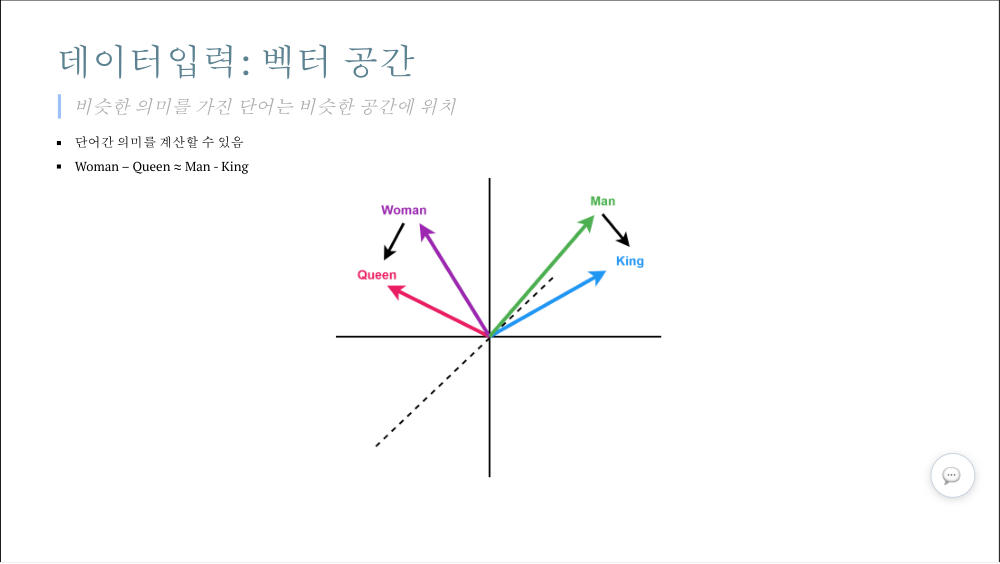

### 쉽게 풀어보기
- 컴퓨터는 글자를 이해하지 못하므로, 단어마다 **좌표(숫자 목록)**를 붙입니다. 이것이 임베딩입니다. GloVe-50은 단어 하나를 50개 숫자로 표현합니다.
- 좌표는 "같이 등장하는 단어"를 보고 학습되므로, 비슷한 문맥에 나오는 cat과 dog는 가까이(유사도 0.92), cat과 car는 멀리(0.36) 놓입니다.
- 방향에도 의미가 담깁니다. `King − Man + Woman ≈ Queen` 처럼 "남성→여성" 이동이 같은 화살표로 표현됩니다. NLPL Calculator 실습(Korea:Busan = Japan:?)이 이 원리입니다. "한국→부산" 관계 화살표를 Japan에 더하면 일본의 대응 도시가 나올 것으로 기대할 수 있습니다.
- `doesnt_match`는 그룹 평균 벡터에서 가장 멀리 떨어진 단어를 고릅니다 → 과일들 사이의 `car`.
- 이 개념은 GPT의 첫 층인 **토큰 임베딩 층**(`nn.Embedding`)과 같습니다. GloVe는 미리 학습된 고정 좌표이고, GPT는 학습 중에 좌표를 함께 조정한다는 점만 다릅니다.

### 노트북 구현
```python
model = api.load("glove-wiki-gigaword-50")      # 사전학습 50차원 GloVe
model.similarity('cat', 'dog')                  # 코사인 유사도 → 0.9218 (cat-car: 0.3638)
model.most_similar('computer', topn=5)          # computers, software, technology, ...
model.doesnt_match(['apple','banana','orange','car'])  # → 'car'
```
온라인 실습: CMU Word Embedding Demo(soldier 위치), NLPL Calculator(Korea:Busan = Japan:?), NLPL Associates(mother), NLPL Visualization(단어 군집).

---

## 2. 입력: 토큰화·데이터셋·임베딩 — `Chapter_2_Exercise_Dataset.ipynb`

### 슬라이드 핵심
- **Tokenizer**: 입력 문장을 의미 단위로 잘라 고유 번호 부여. 자주 쓰는 단어는 길게(압축률↑)
- **서브워드 토크나이저 비교**

| | BPE | WordPiece | Unigram |
|---|---|---|---|
| 방향 | Bottom-up (문자→단어) | Bottom-up | Top-down (전체→가지치기) |
| 기준 | 빈도: 가장 자주 등장하는 쌍 병합 | 우도: P(쌍) / (P(a)·P(b))가 높은 쌍 병합 | 우도: 손실이 적은 것 제거 |
| 사용 모델 | GPT-2/3, RoBERTa | BERT, Electra | T5, ALBERT, mBART |

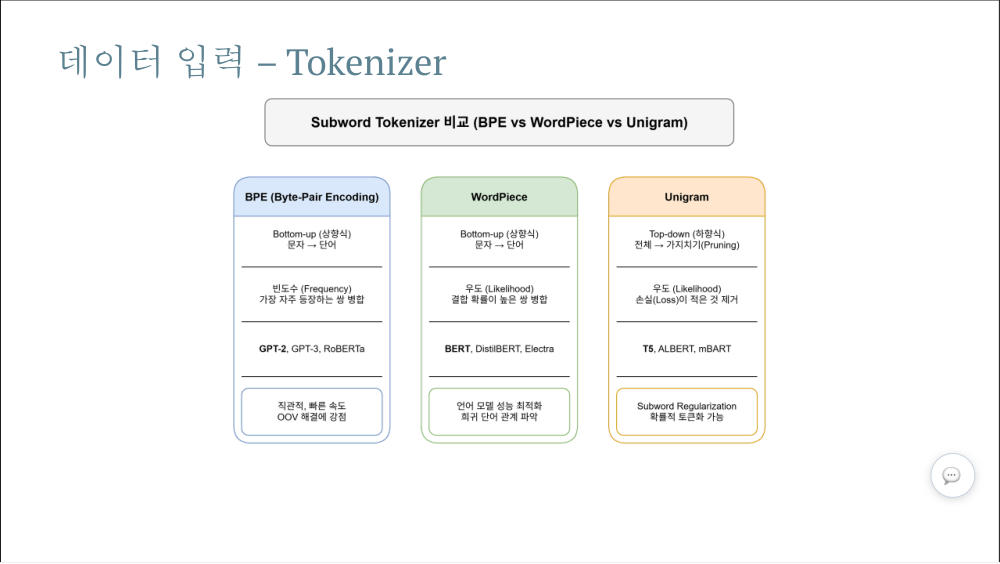

- **위치 인코딩**: 토큰에는 위치 정보가 없음 (`Tom ate the meat ≠ The meat ate Tom`)
  - 절대 위치(학습형 임베딩, Sinusoidal sin/cos), 상대 위치(거리 bias), **RoPE**(2차원씩 짝지어 위치별 각도로 회전)
  - GPT-2와 실습 코드는 **학습형 절대 위치 임베딩**(`nn.Embedding(context_length, emb_dim)`)을 씀

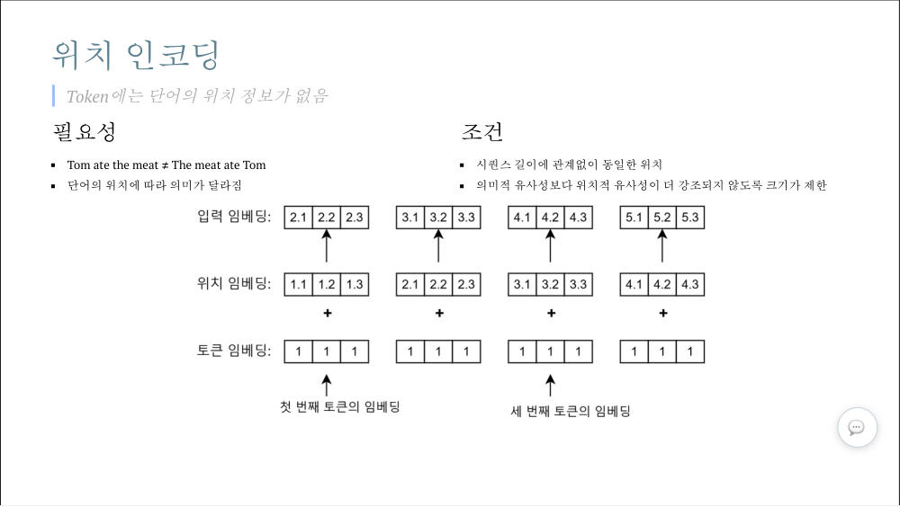

- **Special Token**: `<BOS>`, `<EOS>`, `<PAD>`, `<|user|>`, `<|assistant|>`, `<|system|>`, `<|thought|>`, `<|tool_call|>`… 학습 대상에 포함하되 Padding 토큰은 제외. GPT-2의 `<|endoftext|>` = **50256**
- **데이터셋**: Self-supervised — 라벨 없이 **입력을 한 칸 민 것이 타깃**(next-token prediction)
- **Token 임베딩**: 토큰 ID → 임베딩 가중치 행렬의 해당 행을 조회(lookup)

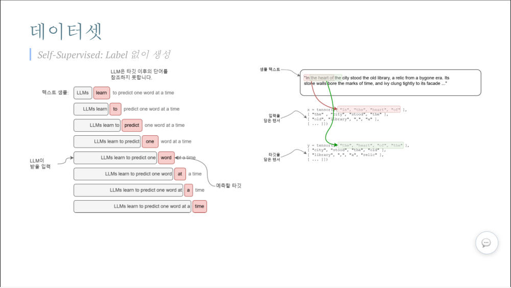
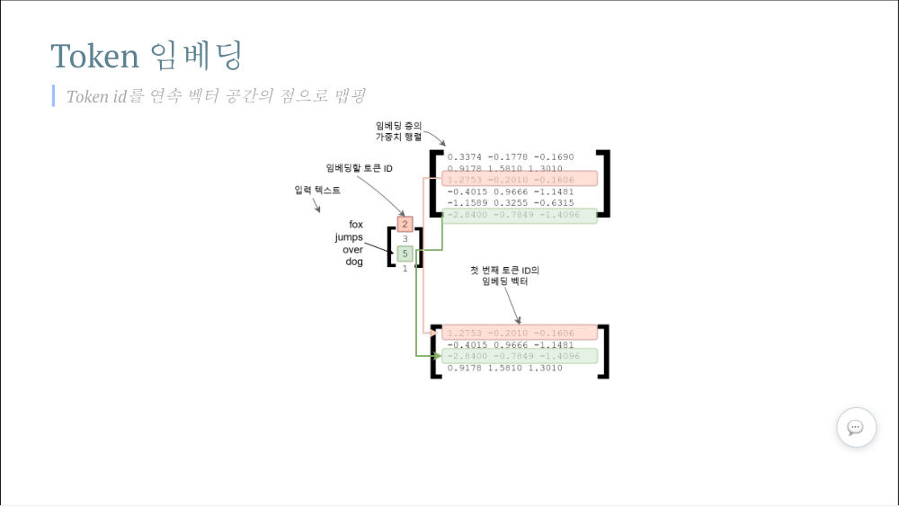

### 쉽게 풀어보기

**왜 단어가 아니라 서브워드로 자르나?**
- 단어 단위면 사전에 없는 단어(신조어, 오타, `someunknownPlace`)를 처리할 수 없고, 글자 단위면 문장이 너무 길어집니다.
- BPE는 그 중간입니다. 글자에서 시작해 **가장 자주 붙어 다니는 쌍**을 계속 합칩니다. 예: `d e e p` → `ee` 병합 → `d ee p` → `dee` 병합 … 자주 쓰는 단어는 한 토큰, 드문 단어는 조각 여러 개가 됩니다.
- 실습 출력에서 사전에 없는 `someunknownPlace`가 토큰 1개가 아니라 여러 조각(some / unknown / Place 등)으로 쪼개지는 것을 볼 수 있습니다. 한국어는 토크나이저에 따라 토큰 수가 크게 달라서(EXAONE이 Qwen보다 효율적) 같은 문장이라도 비용·속도가 달라집니다.

**왜 위치 정보를 더해야 하나?**
- 어텐션은 "어떤 단어들이 있는가"만 보고 순서는 보지 못합니다. 그래서 `Tom ate the meat`와 `The meat ate Tom`이 같아집니다.
- 해결책: 0번 자리, 1번 자리 … 마다 고유한 벡터를 하나씩 만들어 **토큰 벡터에 더합니다**. GPT-2는 이 위치 벡터도 학습합니다(`nn.Embedding(context_length, dim)`).

**학습 데이터는 어떻게 만드나? — 라벨이 필요 없다**
- 문장 자체가 정답지입니다. "LLMs learn to predict"에서 입력 `LLMs learn to` → 정답 `learn to predict`. 한 칸씩 밀면 각 위치마다 "다음 단어 맞히기" 문제가 생깁니다.
- 실습 출력 예: 입력 `[40, 367, 2885, 1464]` → 타깃 `[367, 2885, 1464, 1807]` (한 칸 밀림).
- **슬라이딩 윈도우**: 긴 텍스트를 `max_length` 길이로 잘라 여러 샘플을 만듭니다. `stride`는 다음 조각을 몇 칸 뒤에서 시작할지입니다. stride=1이면 거의 겹치고(샘플 많음, 중복 큼), stride=max_length면 겹치지 않습니다.

**임베딩 층 = 거대한 표에서 행 꺼내기**
- `nn.Embedding(6, 3)`은 6행×3열 표입니다. 토큰 ID가 `[2, 3, 5, 1]`이면 표의 2·3·5·1번째 행을 꺼내 `(4, 3)` 텐서를 만듭니다(실습 출력에서 행이 그대로 복사되는 것을 확인할 수 있음). 수학적으로는 원-핫 벡터 × 가중치 행렬과 같습니다.

**Shape 흐름 (실습 셀 기준)**

| 단계 | Shape | 설명 |
|---|---|---|
| DataLoader 입력 | `[8, 4]` | 배치 8개 × 토큰 4개 |
| 토큰 임베딩 | `[8, 4, 256]` | 토큰마다 256차원 벡터 |
| 위치 임베딩 | `[4, 256]` | 자리 0~3의 벡터 (배치와 무관) |
| 합 | `[8, 4, 256]` | 브로드캐스팅으로 8개 배치 모두에 같은 위치 벡터가 더해짐 |

### 노트북 구현
```python
tokenizer = tiktoken.get_encoding("gpt2")
integers = tokenizer.encode(text, allowed_special={"<|endoftext|>"})
strings  = tokenizer.decode(integers)

x = enc_sample[:context_size]
y = enc_sample[1:context_size+1]            # 타깃 = 입력을 한 칸 민 것

class GPTDatasetV1(Dataset):
    def __init__(self, txt, tokenizer, max_length, stride):
        token_ids = tokenizer.encode(txt, allowed_special={"<|endoftext|>"})
        for i in range(0, len(token_ids) - max_length, stride):   # 슬라이딩 윈도우
            input_chunk  = token_ids[i : i + max_length]
            target_chunk = token_ids[i + 1 : i + max_length + 1]
            ...
    def __getitem__(self, idx):
        return self.input_ids[idx], self.target_ids[idx]

dataloader = DataLoader(dataset, batch_size=batch_size, shuffle=shuffle,
                        drop_last=drop_last, num_workers=num_workers)

embedding_layer = torch.nn.Embedding(vocab_size, output_dim)
token_embeddings = embedding_layer(input_ids)               # ID → 벡터 (행 조회)
pos_embedding_layer = torch.nn.Embedding(context_length, output_dim)
pos_embeddings = pos_embedding_layer(torch.arange(max_length))
input_embeddings = token_embeddings + pos_embeddings          # [8,4,256] + [4,256] → [8,4,256]
```
- `stride=1`이면 윈도우가 1칸씩 겹침, `stride=max_length`이면 겹침 없음
- 추가: Qwen3 vs EXAONE 토크나이저 비교(한국어는 EXAONE, 중국어는 Qwen이 효율적), HF 모델 파일 구조(`config.json`=설계도, `model.safetensors`=가중치, `tokenizer.json`/`vocab.json`/`merges.txt`=토크나이저, `generation_config.json`=생성 옵션)

---

## 3. Attention — `Chapter_3_Excercise_Attention.ipynb` / `..._Viz_Multi_head_attention.ipynb`

### 슬라이드 핵심
- **Attention의 목적**: 같은 단어(apple 🍎/ Apple )도 **문맥에 따라 의미 벡터가 이동**. 주변 토큰 의미를 가중합해 새로운 문맥 의미를 만든다 (`creature` → `A fluffy blue creature`)
- **Q, K, V**: 임베딩에 가중치 행렬 W_q, W_k, W_v를 곱해 생성
  - Query = 질문하는 주체("내가 무엇을 찾는가"), Key = 답하는 대상("나는 어떤 단서인가"), Value = 전달할 정보
- **왜 분리하나**
  - Q·K를 분리 안 하면: 내적이 대칭(`Tom @ meat = meat @ Tom`)이라 누가 누구를 참고하는지 구분 불가, 항상 자기 자신을 가장 주목
  - K·V를 분리 안 하면: 검색용 단서와 전달할 내용이 섞임

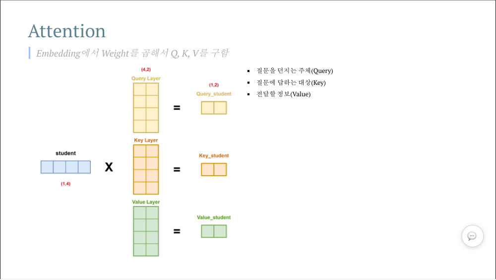

- **Attention Score**: $\text{Attention}(Q,K,V)=\text{softmax}\left(\frac{QK^\top}{\sqrt{d_k}}\right)V$
- **Scale**: 내적값 표준편차가 $\sqrt{d_k}$에 비례해 커짐 → $\sqrt{d_k}$로 나눠 분산을 1로 맞춤(softmax 포화·기울기 소실 방지)
- **전체 흐름**: $z^{(2)} = \sum_t \alpha_{2t}\, v^{(t)}$ — 컨텍스트 벡터 = 어텐션 가중치로 Value를 가중합

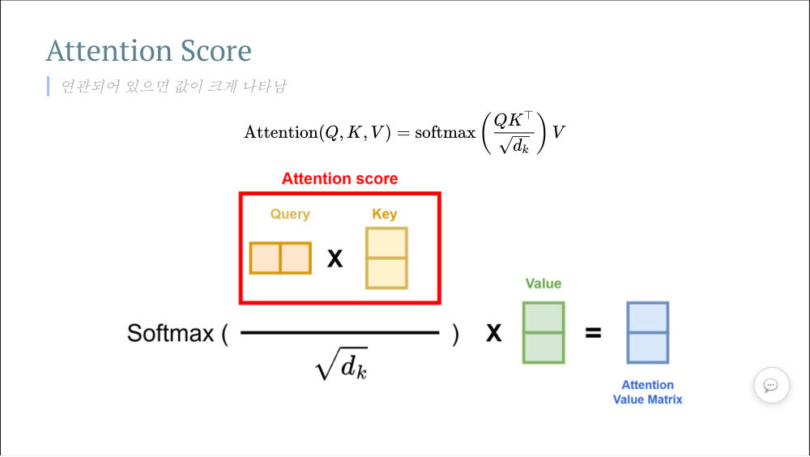
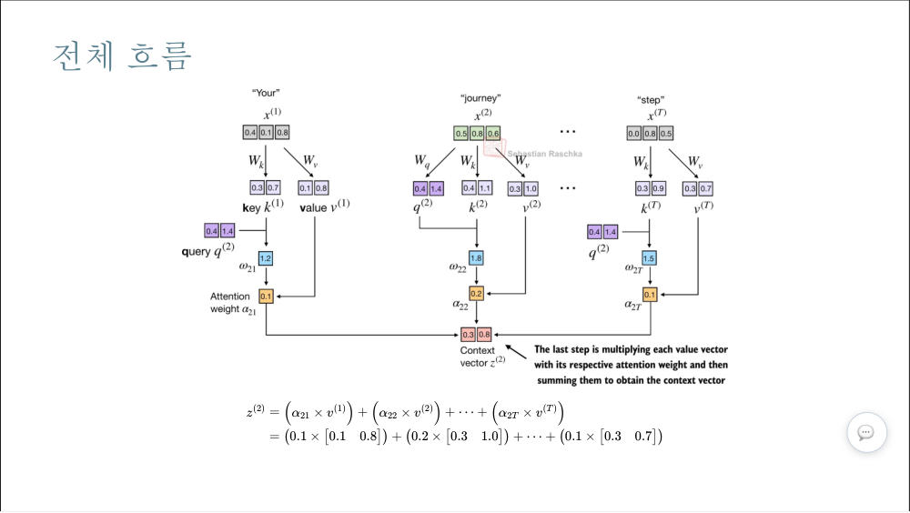

- **Masking**: 현재 토큰이 미래 토큰을 보지 못하게 상삼각을 가림 → 각 행을 다시 정규화
- **Multi-head**: 헤드마다 다른 관점으로 문맥 파악 후 concat. GPT-2 Small = 12 head × 12 layer, DeepSeek R1 = 128 head × 61 layer. 초기 레이어는 문맥 파악, 후반 레이어는 다음 토큰 예측에 집중

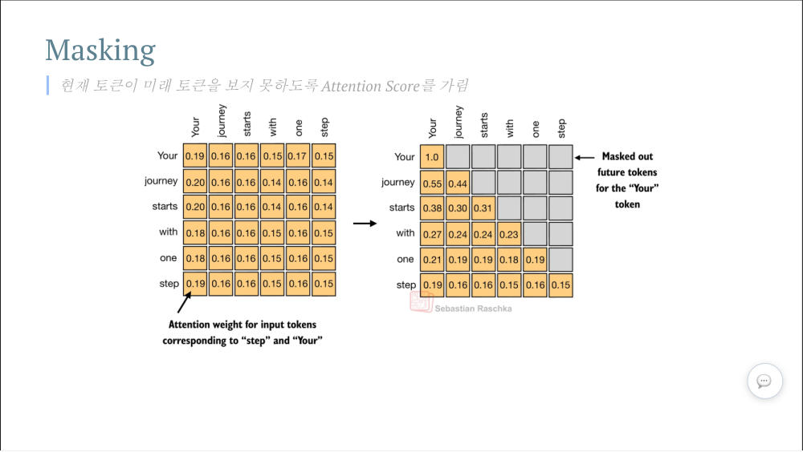
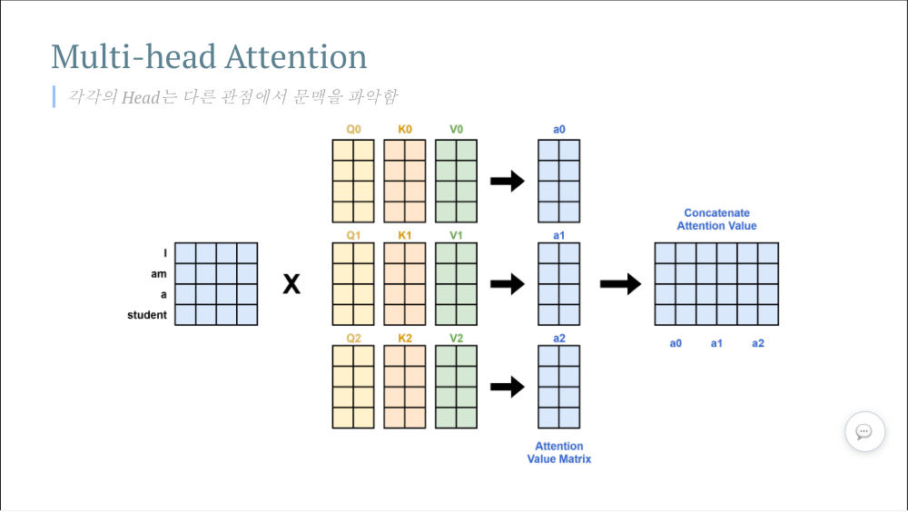

### 쉽게 풀어보기

**어텐션 = 도서관 검색**
- **Query**: 내가 들고 간 검색어("이 `it`이 가리키는 게 뭐지?")
- **Key**: 각 책 표지의 제목/색인("나는 동물 이름이야", "나는 장소야")
- **Value**: 책의 실제 내용
- 검색어와 제목을 비교(Q·K 내적)해 관련도 점수를 매기고 → softmax로 비율로 바꾼 뒤 → 그 비율대로 **책 내용(V)을 섞어서** 가져옵니다. 결과가 그 토큰의 새 "문맥 벡터"입니다.
- 예: "The animal didn't cross the street because **it** was too tired"에서 `it`의 Query는 `animal`의 Key와 가장 잘 맞아서, `it`의 새 벡터에는 `animal`의 정보가 많이 섞입니다.

**단계별 계산 (Ch3 실습: "Your journey starts with one step", 6토큰, d_in=3, d_out=2)**

| 단계 | 연산 | Shape (batch=2) |
|---|---|---|
| 입력 | 토큰 임베딩 | `(2, 6, 3)` |
| Q, K, V | `W_query(x)` 등 (Linear 3→2) | 각 `(2, 6, 2)` |
| 점수 | `queries @ keys.transpose(1, 2)` | `(2, 6, 6)` — 모든 토큰 쌍의 점수 |
| 마스킹 | 대각선 위를 `-inf` | `(2, 6, 6)` |
| 가중치 | `softmax(점수 / √2, dim=-1)` | `(2, 6, 6)` — 각 행의 합이 1 |
| 출력 | `attn_weights @ values` | `(2, 6, 2)` — 토큰마다 문맥 벡터 |

**왜 √d_k로 나누나?**
- 차원이 64면 내적은 64개 곱의 합이라 값이 ±8 정도로 커집니다. softmax에 큰 값이 들어가면 한 칸만 1, 나머지는 0에 가까워지고(포화) 기울기가 거의 사라집니다. √64=8로 나눠 다시 ±1 수준으로 맞춥니다.

**마스킹은 "커닝 방지"**
- GPT는 다음 단어를 맞혀야 하는데, 학습 때 문장 전체가 한꺼번에 들어갑니다. 미래 단어를 보면 답을 베끼는 셈이므로 점수 행렬의 오른쪽 위(미래)를 `-inf`로 덮습니다.
- 결과: 1번째 행 `Your`는 자기만 봄(1.0), 2번째 행 `journey`는 `Your`와 자신만 봄(0.55, 0.44) … 이렇게 **아래 삼각형만 남습니다**.

**멀티헤드 = 여러 명이 각자 다른 관점으로 읽기**
- 한 헤드는 문법(주어-동사), 다른 헤드는 대명사가 가리키는 대상, 또 다른 헤드는 바로 앞 단어 … 처럼 서로 다른 관계를 봅니다. 각자 결과를 이어 붙인(concat) 뒤 `out_proj`로 섞습니다.
- 효율적 구현은 큰 Q/K/V를 한 번에 만든 뒤 `view`로 헤드 수만큼 쪼갭니다: `(b, T, d_out)` → `(b, T, h, d_out/h)` → `transpose(1,2)` → `(b, h, T, hd)`. 이러면 헤드들을 for문 없이 **한 번의 행렬곱으로 병렬 계산**할 수 있습니다.

### 노트북 구현 — `CausalAttention`
```python
class CausalAttention(nn.Module):
    def __init__(self, d_in, d_out, context_length, dropout, qkv_bias=False):
        super().__init__()
        self.W_query = nn.Linear(d_in, d_out, bias=qkv_bias)
        self.W_key   = nn.Linear(d_in, d_out, bias=qkv_bias)
        self.W_value = nn.Linear(d_in, d_out, bias=qkv_bias)
        self.dropout = nn.Dropout(dropout)
        self.register_buffer('mask', torch.triu(torch.ones(context_length, context_length), diagonal=1))

    def forward(self, x):
        b, num_tokens, d_in = x.shape
        keys    = self.W_key(x)
        queries = self.W_query(x)
        values  = self.W_value(x)
        attn_scores = queries @ keys.transpose(1, 2)
        attn_scores.masked_fill_(self.mask.bool()[:num_tokens, :num_tokens], -torch.inf)
        attn_weights = torch.softmax(attn_scores / keys.shape[-1]**0.5, dim=-1)
        attn_weights = self.dropout(attn_weights)
        context_vec = attn_weights @ values
        return context_vec
```
- `torch.triu(..., diagonal=1)`: 대각선 위(미래)만 1 → `-inf`로 채우면 softmax 후 0
- `register_buffer`: 학습 대상은 아니지만 `state_dict`에 저장되고 `.to(device)`로 같이 이동

### `MultiHeadAttention` (헤드를 텐서 차원으로 분할하는 효율적 버전)
```python
self.head_dim = d_out // num_heads
self.out_proj = nn.Linear(d_out, d_out)
...
keys = keys.view(b, num_tokens, self.num_heads, self.head_dim).transpose(1, 2)  # (b, h, T, hd)
attn_scores = queries @ keys.transpose(2, 3)                                      # (b, h, T, T)
attn_weights = torch.softmax(attn_scores / keys.shape[-1]**0.5, dim=-1)
context_vec = (attn_weights @ values).transpose(1, 2)                             # (b, T, h, hd)
context_vec = context_vec.contiguous().view(b, num_tokens, self.d_out)            # 헤드 결합
context_vec = self.out_proj(context_vec)
```
- `MultiHeadAttentionWrapper`는 `CausalAttention`을 여러 개 만들어 `torch.cat(..., dim=-1)` → 출력 차원 = `d_out × num_heads`
- 시각화 노트북: GPT-2 Small에 `register_forward_hook`으로 각 블록의 어텐션 가중치를 수집 → 레이어별 12개 헤드 히트맵, 레이어/헤드 선택 위젯으로 토큰 간 연결선 표시

---

## 4. GPT 레이어·입출력 — `Chapter_4_Excercise_GPT.ipynb`

### 슬라이드 핵심
- **GPT 구조**: Decoder만 사용. `토큰 임베딩 + 위치 임베딩 → Dropout → [Transformer Block × N] → 최종 LayerNorm → 출력층(Linear)`
- **Transformer Block**: `LN1 → Masked MHA → Dropout → +shortcut → LN2 → FFN → Dropout → +shortcut` (Pre-LN)

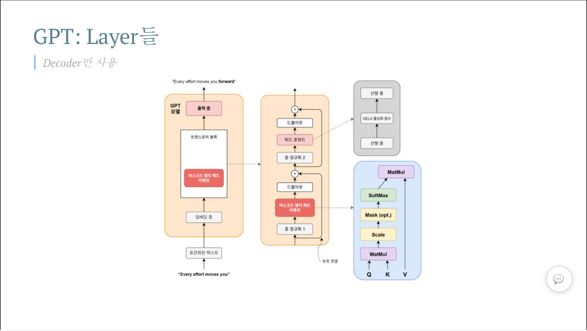

- **Dropout**: softmax 이후 랜덤으로 0으로 마스킹 → 과적합 방지 (대규모 LLM 학습에선 잘 안 씀)
- **Layer Normalization**: 토큰별로 평균 0·분산 1로 정규화 후 학습 파라미터 γ(scale)·β(shift) 적용, ε은 0으로 나누기 방지
  $\hat{x}_i=\frac{x_i-\mu}{\sqrt{\sigma^2+\epsilon}},\quad y_i=\gamma\hat{x}_i+\beta$
  (참고: RMSNorm은 평균 빼기를 생략하고 스케일만 맞춤)
- **활성화 함수**: Sigmoid(기울기 소실) → ReLU(Dying ReLU) → **GELU**(부드러움, GPT-2) → Swish/GLU/SwiGLU(현대 LLM)
  $\text{GELU}(x)\approx 0.5x\left(1+\tanh\left(\sqrt{2/\pi}\,(x+0.044715x^3)\right)\right)$
- **FFN**: 차원을 4배로 확장 → 활성화 → 원래 차원으로 축소(지식의 저장소)
- **Residual connection**: 변화량만 학습하므로 깊어도 학습이 안정적
- **입출력 차원**: 블록 입출력 차원이 같아야 쌓을 수 있고 residual이 가능. `(B,T) → (B,T,768) → (B,T,768) → (B,T,50257)`

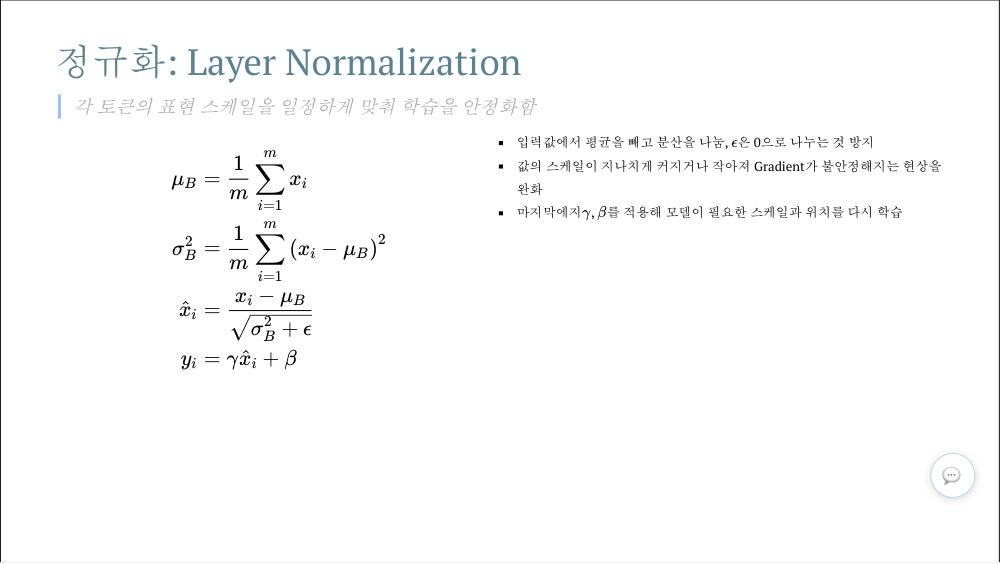
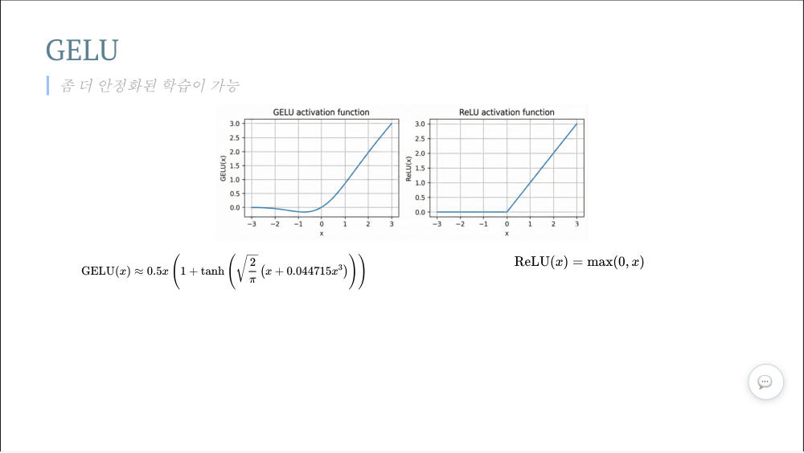
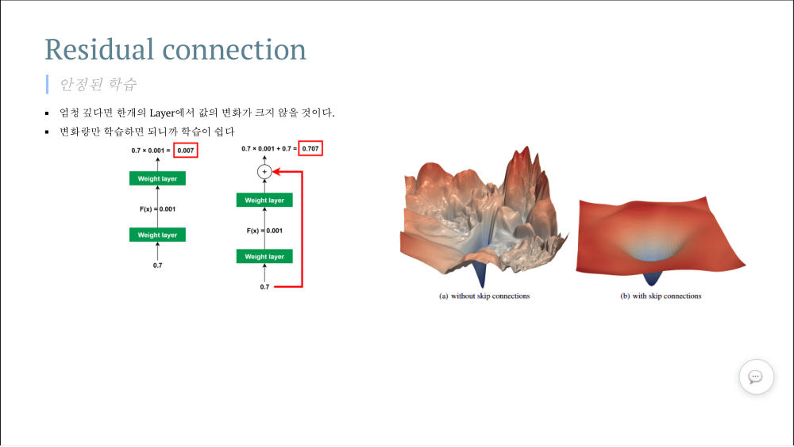
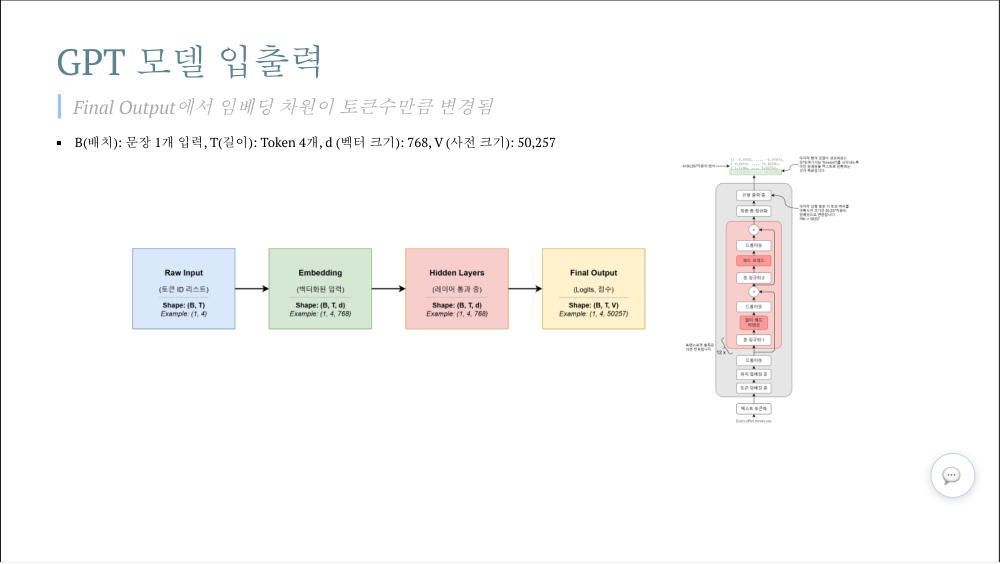

- **출력 토큰 생성**: 마지막 위치 logits → softmax → 가장 큰 값의 인덱스 = 다음 토큰 ID → 입력 뒤에 붙여 반복(Autoregressive)

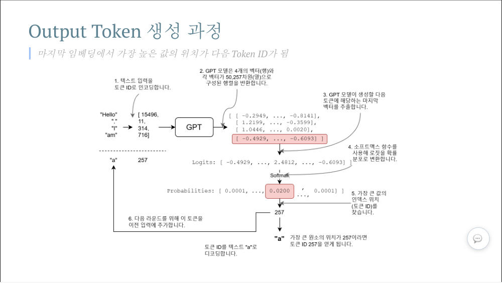

### 쉽게 풀어보기

**GPT 한 번 통과할 때의 Shape 흐름 ("Hello, I am" = 4토큰, GPT-2 Small)**

| 단계 | Shape | 하는 일 |
|---|---|---|
| 입력 토큰 ID | `(1, 4)` | `[15496, 11, 314, 716]` |
| 토큰 임베딩 + 위치 임베딩 | `(1, 4, 768)` | 각 토큰을 768차원 벡터로 |
| Transformer Block × 12 | `(1, 4, 768)` | 크기는 그대로, 내용만 계속 다듬어짐 |
| 최종 LayerNorm | `(1, 4, 768)` | |
| 출력층 `out_head` | `(1, 4, 50257)` | 위치마다 "다음 토큰 후보 50,257개의 점수" |
| 마지막 위치만 | `(1, 50257)` | 4번째 토큰 다음에 올 단어의 점수 |
| argmax | `(1, 1)` | 가장 점수 높은 토큰 ID |

- 블록 입출력 크기가 같기 때문에 블록을 몇 개든 쌓을 수 있고, `x + shortcut`(잔차 연결)도 가능합니다.

**Transformer Block의 두 부분 — "모으기"와 "생각하기"**
- **어텐션**: 다른 토큰에서 필요한 정보를 **모아 옵니다**(토큰 간 소통).
- **FFN**: 모은 정보를 토큰마다 **혼자 가공**합니다. 768 → 3072(4배로 넓혀 세밀하게 표현) → GELU → 768로 되돌림. 사실·지식이 주로 저장되는 곳으로 알려져 있습니다.
- 각 부분 앞에 LayerNorm(Pre-LN), 뒤에 Dropout과 잔차 덧셈이 붙습니다.

**LayerNorm — "토큰마다 값의 크기를 일정하게"**
- 벡터 [1, 2, 3, 6]은 평균 3, 분산 3.5 → (x−3)/√3.5 = [−1.07, −0.53, 0, 1.60]. 층을 거치며 값이 폭주하거나 0으로 줄어드는 것을 막아 학습을 안정시킵니다.
- 정규화 후 `scale`(γ, 초기 1)과 `shift`(β, 초기 0)를 학습해, 모델이 필요하면 원래 분포로 되돌릴 여지를 남깁니다.
- `dim=-1`: 배치·위치와 상관없이 **각 토큰의 768개 값끼리** 정규화합니다(BatchNorm은 배치 방향).

**GELU vs ReLU**
- ReLU는 음수를 칼같이 0으로 자르고, GELU는 0 근처를 부드럽게 곡선으로 처리해 약간의 음수 정보를 남깁니다. 미분이 매끄러워 깊은 모델 학습이 안정적입니다.

**잔차 연결 — "변화량만 배우기"**
- 출력 = 입력 + 블록이 계산한 변화량. 블록이 아무것도 못 배워도 최소한 입력은 그대로 전달되므로, 층을 깊게 쌓아도 신호와 기울기가 끊기지 않습니다.

**텍스트 생성 루프 (Greedy)**
1. 현재 문장을 모델에 넣는다 → 2. 마지막 위치의 점수만 본다 → 3. 가장 높은 토큰을 고른다 → 4. 문장 뒤에 붙인다 → 1로 반복.
- 학습 전(가중치가 랜덤)이므로 의미 없는 토큰이 나오는 것이 정상입니다. Ch5에서 학습한 뒤 같은 루프를 다시 씁니다.

### 노트북 구현
```python
class LayerNorm(nn.Module):
    def __init__(self, emb_dim):
        super().__init__()
        self.eps = 1e-5
        self.scale = nn.Parameter(torch.ones(emb_dim))
        self.shift = nn.Parameter(torch.zeros(emb_dim))
    def forward(self, x):
        mean = x.mean(dim=-1, keepdim=True)
        var  = x.var(dim=-1, keepdim=True, unbiased=False)
        norm_x = (x - mean) / torch.sqrt(var + self.eps)
        return self.scale * norm_x + self.shift

class GELU(nn.Module):
    def forward(self, x):
        return 0.5 * x * (1 + torch.tanh(torch.sqrt(torch.tensor(2.0 / torch.pi)) *
                                         (x + 0.044715 * torch.pow(x, 3))))

class FeedForward(nn.Module):
    def __init__(self, cfg):
        super().__init__()
        self.layers = nn.Sequential(
            nn.Linear(cfg["emb_dim"], 4 * cfg["emb_dim"]),
            GELU(),
            nn.Linear(4 * cfg["emb_dim"], cfg["emb_dim"]),
        )

class TransformerBlock(nn.Module):
    def forward(self, x):
        shortcut = x
        x = self.norm1(x); x = self.att(x); x = self.drop_shortcut(x)
        x = x + shortcut
        shortcut = x
        x = self.norm2(x); x = self.ff(x);  x = self.drop_shortcut(x)
        x = x + shortcut
        return x

class GPTModel(nn.Module):
    def __init__(self, cfg):
        super().__init__()
        self.tok_emb = nn.Embedding(cfg["vocab_size"], cfg["emb_dim"])
        self.pos_emb = nn.Embedding(cfg["context_length"], cfg["emb_dim"])
        self.drop_emb = nn.Dropout(cfg["drop_rate"])
        self.trf_blocks = nn.Sequential(*[TransformerBlock(cfg) for _ in range(cfg["n_layers"])])
        self.final_norm = LayerNorm(cfg["emb_dim"])
        self.out_head = nn.Linear(cfg["emb_dim"], cfg["vocab_size"], bias=False)
    def forward(self, in_idx):
        batch_size, seq_len = in_idx.shape
        tok_embeds = self.tok_emb(in_idx)
        pos_embeds = self.pos_emb(torch.arange(seq_len, device=in_idx.device))
        x = tok_embeds + pos_embeds
        x = self.drop_emb(x)
        x = self.trf_blocks(x)
        x = self.final_norm(x)
        logits = self.out_head(x)
        return logits

def generate_text_simple(model, idx, max_new_tokens, context_size):
    for _ in range(max_new_tokens):
        idx_cond = idx[:, -context_size:]                 # 컨텍스트 길이 초과분 잘라냄
        with torch.no_grad():
            logits = model(idx_cond)
        logits = logits[:, -1, :]                          # 마지막 위치만
        idx_next = torch.argmax(logits, dim=-1, keepdim=True)  # Greedy
        idx = torch.cat((idx, idx_next), dim=1)
    return idx
```
GPT-2 Small(124M) 설정: `vocab_size=50257, context_length=1024, emb_dim=768, n_heads=12, n_layers=12, drop_rate=0.1, qkv_bias=False`.
학습 전 모델이라 "Hello, I am" 뒤에 의미 없는 토큰 10개가 생성되는 것이 정상.

---

## 5. 사전학습 — `Chapter_5_Excercise_Pretraining.ipynb`

### 슬라이드 핵심
- **학습 과정**: 순전파 → Loss 계산 → 역전파(Chain Rule로 기울기) → 경사하강법(가중치 업데이트) 반복
- **데이터 분할**: Train / Validation / Test. Validation 오차가 다시 오르는 지점이 과적합 → 학습 중단

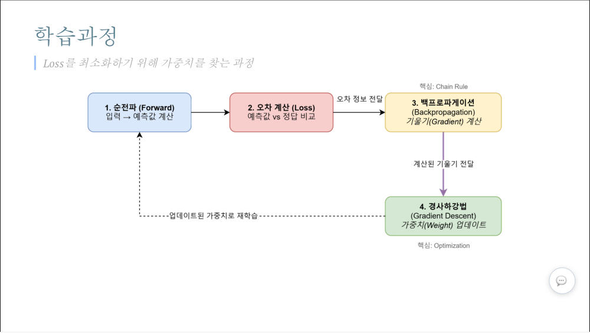

- **비용함수**: 회귀=MSE, 분류=Cross Entropy. LLM은 "정답 토큰 확률"을 모두 1로 만드는 것이 목표
  - 계산: logits → softmax 확률 → 정답 토큰 확률 추출 → log → 평균 → 음수 부호 = Loss

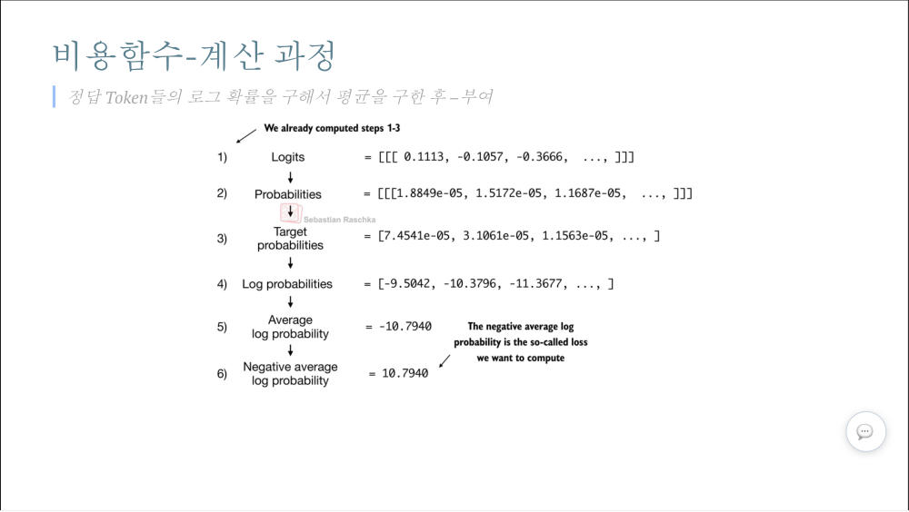

- **Adam/AdamW**: 모멘텀(방향) + 파라미터별 적응형 보폭. $w_{t+1}=w_t-\frac{\eta}{\sqrt{\hat v_t}+\epsilon}\hat m_t$. AdamW는 weight decay(규제) 분리 적용
- **Epoch/Step/Batch**: 1,000개 데이터, batch 100 → 1 epoch = 10 step. 작은 배치=일반화 유리·느림, 큰 배치=안정·과적합 위험
- **Training vs Inference**: 학습은 마스킹 덕분에 모든 위치를 한 번에(병렬), 추론은 한 토큰씩(Autoregressive)

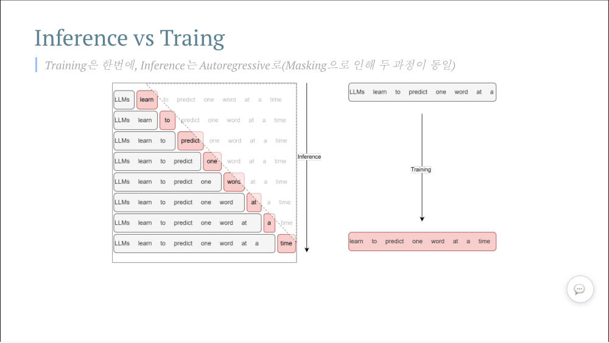

- **디코딩 전략**
  - Temperature: softmax 전에 logits를 T로 나눔. T↑ → 분포 평평(다양성↑), T↓ → 뾰족(결정적)
  - Top-K: 상위 K개만 남기고 나머지는 `-inf` 마스킹 → softmax → 확률 기반 샘플링

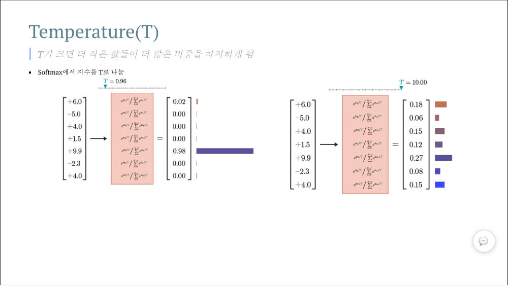
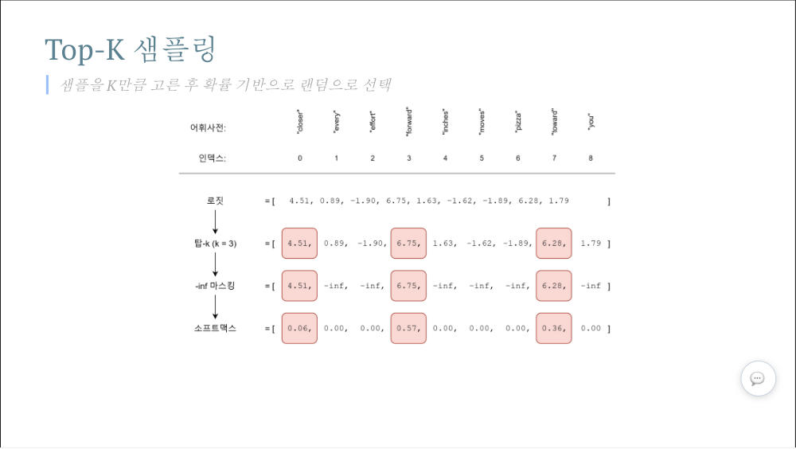

### 쉽게 풀어보기

**학습 1 step = 4박자**
1. `optimizer.zero_grad()` — 지난번 기울기를 지움. PyTorch는 기울기를 **누적**하므로 안 지우면 이전 배치 기울기가 계속 더해집니다.
2. `loss = calc_loss_batch(...)` — 순전파로 예측하고 정답과 비교해 벌점 계산
3. `loss.backward()` — 연쇄법칙으로 모든 가중치의 기울기 계산
4. `optimizer.step()` — 기울기 반대 방향으로 가중치를 조금 이동

**왜 `flatten`을 하나?**
- 모델 출력은 `(배치 2, 길이 256, 어휘 50257)`, 정답은 `(2, 256)`입니다. `F.cross_entropy`는 `(샘플 수, 클래스 수)`와 `(샘플 수,)`를 받으므로 앞 두 차원을 합쳐 `(512, 50257)`과 `(512,)`로 펴줍니다. 즉 **512개 위치 각각을 "50,257지선다 문제"로 보고 평균 벌점**을 냅니다.

**`model.train()` vs `model.eval()` + `torch.no_grad()`**
- `train()`: Dropout 켜기. `eval()`: Dropout 끄기(평가 결과가 매번 같도록).
- `no_grad()`: 기울기 계산용 기록을 하지 않아 메모리와 시간을 아낍니다. 평가·생성할 때 사용합니다.

**`unsqueeze(0)` / `squeeze(0)`**
- 모델은 항상 `(배치, 길이)`를 받습니다. 문장 1개 `[12, 34, 56]`(shape `(3,)`)을 `[[12, 34, 56]]`(shape `(1, 3)`)로 바꾸는 게 `unsqueeze(0)`, 되돌리는 게 `squeeze(0)`입니다.

**Train loss vs Validation loss로 과적합 읽기**
- 둘 다 내려가면 정상 학습. Train은 계속 내려가는데 Val이 멈추거나 오르면 **외우기 시작한 것(과적합)**.
- 실습 데이터(`the-verdict.txt`, 5천 토큰)는 매우 작아서 train loss는 9.98 → 5.6으로 떨어지지만 val loss는 6.5 근처에서 멈춥니다. 생성 결과가 ", and, and, and…"처럼 반복되는 것도 데이터가 적어 생기는 현상입니다.

**AdamW 한 줄 요약**
- 기울기의 **평균 방향(모멘텀)**으로 관성 있게 가고, 기울기가 자주 크게 흔들리는 파라미터는 **보폭을 줄이는** 옵티마이저. `weight_decay`는 가중치가 지나치게 커지지 않게 매 step 조금씩 줄여 과적합을 막습니다.

**Temperature와 Top-K 숫자 예시**
- logits [6, 4, 2]에서 T=1이면 확률 ≈ [0.87, 0.12, 0.02], T=2(나누면 [3, 2, 1])이면 ≈ [0.67, 0.24, 0.09] → 덜 뾰족해져 다양한 단어가 나옴. T를 0에 가깝게 하면 사실상 argmax(Greedy).
- Top-K=3: 상위 3개만 남기고 나머지를 `-inf`로 만든 뒤 softmax → 엉뚱한 하위 토큰이 뽑힐 가능성을 원천 차단하면서도 상위 후보 중에서는 랜덤성을 유지합니다.

### 노트북 구현
```python
def calc_loss_batch(input_batch, target_batch, model, device):
    input_batch, target_batch = input_batch.to(device), target_batch.to(device)
    logits = model(input_batch)                            # (B, T, V)
    loss = torch.nn.functional.cross_entropy(
        logits.flatten(0, 1),                              # (B*T, V)
        target_batch.flatten()                             # (B*T,)
    )
    return loss

def train_model_simple(model, train_loader, val_loader, optimizer, device, num_epochs,
                       eval_freq, eval_iter, start_context, tokenizer):
    for epoch in range(num_epochs):
        model.train()
        for input_batch, target_batch in train_loader:
            optimizer.zero_grad()                          # 1) 기울기 초기화
            loss = calc_loss_batch(input_batch, target_batch, model, device)  # 2) 순전파+손실
            loss.backward()                                # 3) 역전파
            optimizer.step()                               # 4) 가중치 업데이트
            ...
            if global_step % eval_freq == 0:
                train_loss, val_loss = evaluate_model(...)  # model.eval() + torch.no_grad()

def text_to_token_ids(text, tokenizer):
    return torch.tensor(tokenizer.encode(text)).unsqueeze(0)   # 배치 차원 추가
def token_ids_to_text(token_ids, tokenizer):
    return tokenizer.decode(token_ids.squeeze(0).tolist())     # 배치 차원 제거

optimizer = torch.optim.AdamW(model.parameters(), lr=settings["learning_rate"],
                              weight_decay=settings["weight_decay"])
```
- 학습 설정: `context_length=256`(원본 1024에서 축소), `lr=5e-4`, `epochs=10`, `batch_size=2`, `weight_decay=0.1`, 데이터 `the-verdict.txt` 9:1 분할
- `generate()`: EOS(`eos_id`)가 나오면 중단하는 버전(Greedy). Ch7에서 재사용
- 결과: Train loss 9.98 → 약 5.6 (작은 데이터라 val loss는 6.5대에서 정체 = 과적합 경향), 모델 `outputs/model.pth` 저장 후 재로드

---

## 6. 분류 미세튜닝 — `Chapter_6_Excercise_Finetuning_Classification.ipynb`

### 슬라이드 핵심
- 분류용으로 **마지막 출력층을 교체**: `Linear(768 → 50257)` → `Linear(768 → 2)` (spam / not spam)
- 짧은 입력은 `50256`으로 **패딩**해 가장 긴 문장 길이에 맞춤
- 타깃은 0(ham)/1(spam) 라벨
- 예측: **마지막 토큰** 출력(causal mask 때문에 모든 토큰 정보를 보는 유일한 위치) → softmax → argmax

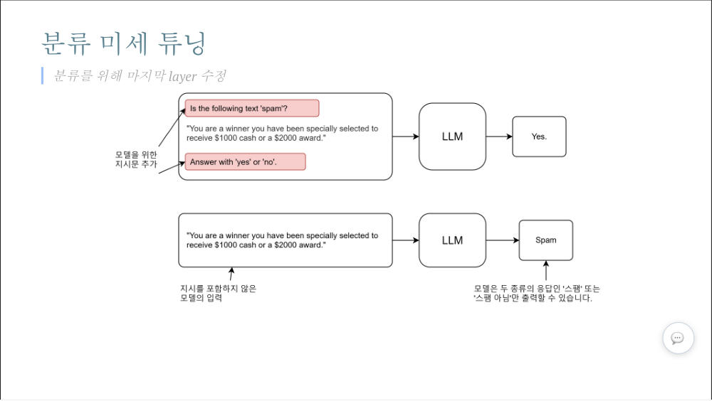
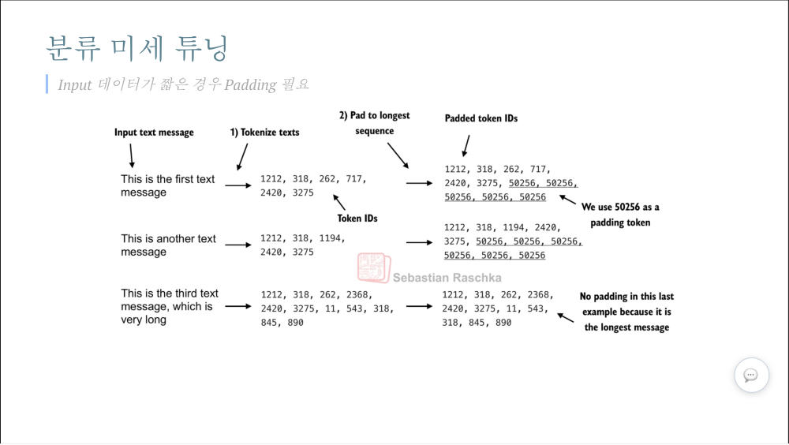
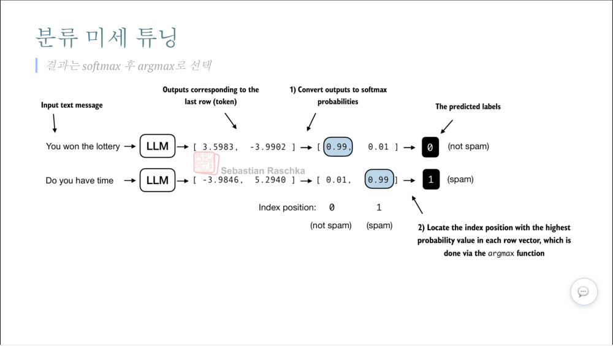

### 쉽게 풀어보기

**사전학습 모델을 "스팸 판별기"로 바꾸는 법**
- 사전학습된 GPT-2는 이미 영어를 잘 읽습니다. 출력층만 "다음 단어 50,257개 중 하나"에서 "**스팸이냐 아니냐 2개 중 하나**"로 바꿔 끼우면 됩니다.
- `Linear(768 → 50257)` → `Linear(768 → 2)`: 마지막 위치의 768차원 벡터를 받아 [정상 점수, 스팸 점수]를 냅니다.

**왜 마지막 토큰을 쓰나?**
- 인과 마스크 때문에 1번째 토큰은 자기만, 2번째는 1~2번째만 … 볼 수 있습니다. **문장 전체를 다 본 위치는 마지막 토큰뿐**이므로 그 벡터가 문장 요약 역할을 합니다.
- 예측: 마지막 위치 logits `[3.60, −3.99]` → softmax `[0.99, 0.01]` → argmax 0 → "not spam".

**왜 전체를 학습하지 않고 일부만 푸나?**
- 1억 2천만 개 파라미터를 전부 학습하면 느리고, 수천 개 문장으로는 기존 언어 지식을 망가뜨릴 수 있습니다.
- 그래서 전체를 얼리고(`requires_grad=False`) **새 출력층 + 마지막 Transformer 블록 + 최종 LayerNorm**만 학습합니다. 출력에 가까운 층일수록 과제에 특화된 정보를 담기 때문입니다.
- 새로 만든 `nn.Linear`는 기본값이 `requires_grad=True`라 따로 풀 필요가 없습니다.

**패딩과 데이터 균형**
- 문장 길이가 제각각이라 배치로 묶으려면 가장 긴 문장 길이에 맞춰 뒤를 `50256`(`<|endoftext|>`)으로 채웁니다. 검증·테스트도 학습셋 최대 길이에 맞춰야 모델이 같은 형식을 받습니다.
- 원래 데이터는 정상 메일이 훨씬 많아 "다 정상"이라고만 해도 정확도가 높게 나옵니다. 그래서 정상 메일을 스팸 수만큼만 뽑아 **50:50으로 맞춘 뒤** 학습합니다.

### 노트북 구현
```python
# 데이터: SMS Spam Collection → ham을 spam 개수만큼 언더샘플링(균형) → 7:1:2 분할
class SpamDataset(Dataset):
    def __init__(self, csv_file, tokenizer, max_length=None, pad_token_id=50256):
        ...
        self.encoded_texts = [encoded_text[:self.max_length] for encoded_text in self.encoded_texts]  # 자르기
        self.encoded_texts = [encoded_text + [pad_token_id] * (self.max_length - len(encoded_text))
                              for encoded_text in self.encoded_texts]                                # 패딩
    def __getitem__(self, index):
        label = self.data.iloc[index]["Label"]
        ...

def calc_loss_batch(input_batch, target_batch, model, device):
    logits = model(input_batch)[:, -1, :]          # 마지막 토큰만
    return torch.nn.functional.cross_entropy(logits, target_batch)

# 미세튜닝 설정
for param in model.parameters():
    param.requires_grad = False                    # 전체 동결
model.out_head = torch.nn.Linear(in_features=BASE_CONFIG["emb_dim"], out_features=num_classes)  # 새 층은 학습됨
for param in model.trf_blocks[-1].parameters():
    param.requires_grad = True                     # 마지막 블록만 해제
for param in model.final_norm.parameters():
    param.requires_grad = True                     # 최종 LayerNorm 해제
optimizer = torch.optim.AdamW(model.parameters(), lr=5e-5, weight_decay=0.1)
```
- 검증/테스트 데이터셋은 `max_length=train_dataset.max_length`로 맞춤
- 정확도: `calc_accuracy_loader` — 마지막 토큰 logits의 argmax와 라벨 비교
- 결과: 3 epoch에 Train/Val 정확도 90% 도달

---

## 6+. LoRA — `Chapter_6_Excercise_Finetuning_Classification_LoRA.ipynb`

### 슬라이드 핵심
- LLM 전체 학습은 메모리가 많이 듦(10B 모델 ≈ 160GB: 파라미터+기울기+옵티마이저 상태)
- **LoRA**: 원래 가중치 W는 동결, 저랭크 행렬 A(d×r)·B(r×k)만 학습. $h = Wx + \Delta W x = Wx + \frac{\alpha}{r}xAB$
- 모델이 클수록 학습 파라미터 비율이 작아짐(rank 512에서도 7B의 1.22%)
- **초기화**: **A는 랜덤, B는 0** → 학습 시작 시 ΔW=0이라 원래 모델과 동일하게 출발. 둘 다 랜덤이면 원래 모델이 망가지고, 둘 다 0이면 기울기가 0이라 학습이 안 됨. 첫 역전파에선 B만 업데이트
- QLoRA: 기본 가중치를 4-bit NF4로 양자화해 메모리 절감, 계산은 BF16으로 역양자화 후 수행 (노트북에서는 미구현)

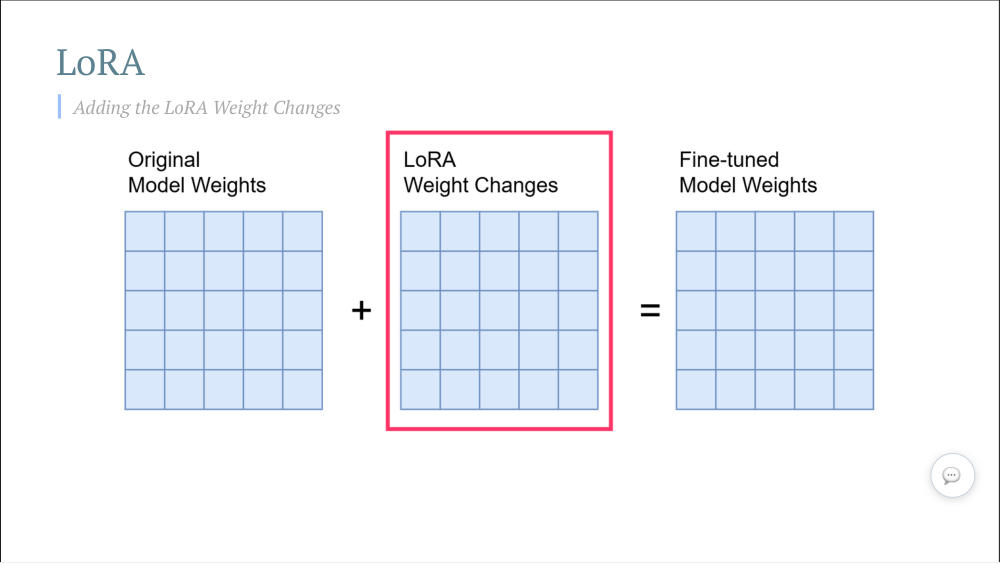
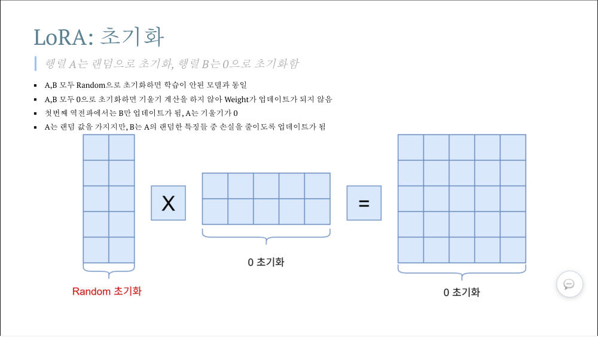

### 쉽게 풀어보기

**LoRA = 원본은 그대로 두고 "수정 메모"만 붙이기**
- 미세조정은 결국 가중치 W를 W + ΔW로 바꾸는 일입니다. LoRA는 ΔW를 통째로 학습하지 않고 **작은 두 행렬의 곱 A·B**로 근사합니다.
- 숫자로 보면: 768×768 가중치 = 589,824개. rank 16 LoRA는 A(768×16) + B(16×768) = **24,576개(약 4%)**만 학습합니다.
- "변화량은 생각보다 단순하다(저랭크)"는 가정 덕분에 이 정도로도 성능이 잘 나옵니다. 실습에서 학습 파라미터는 약 2.67M(전체의 약 2%)뿐인데 테스트 정확도는 98%가 나옵니다.

**forward 한 줄 해석**: `self.linear(x) + (alpha/rank) * (x @ A @ B)`
- 원래 층의 출력에 LoRA가 계산한 보정값을 더합니다. `alpha/rank`는 보정값의 세기 조절(실습은 16/16 = 1).

**초기화가 중요한 이유 (B = 0)**
- 학습 시작 순간 A·B = 0이므로 모델 출력이 **원래 사전학습 모델과 똑같습니다**. 학습하면서 B가 조금씩 0에서 벗어나 필요한 만큼만 수정합니다.
- 둘 다 랜덤이면 시작부터 원래 지식을 망가뜨리고, 둘 다 0이면 기울기가 서로 0을 곱해 영원히 0 → 학습이 안 됩니다.

**`replace_linear_with_lora`의 재귀**
- 모델 안의 모든 하위 모듈을 돌며 `nn.Linear`를 만나면 `LinearWithLoRA`로 갈아 끼우고, 아니면 그 안으로 다시 들어갑니다(Q/K/V, out_proj, FFN, 출력층까지 전부 적용).
- 순서가 중요합니다: **전체 동결 → LoRA 주입**. 주입 후 새로 생긴 A, B만 `requires_grad=True`로 남습니다.

**QLoRA (개념만)**: 얼린 원본 W를 4비트로 압축해 메모리를 크게 줄이고, 계산할 때만 BF16으로 풀어서 씁니다. 24GB GPU에서 30B급 모델 미세조정을 가능하게 합니다.

### 노트북 구현
```python
class LoRALayer(nn.Module):
    def __init__(self, in_dim, out_dim, rank, alpha):
        super().__init__()
        self.A = nn.Parameter(torch.empty(in_dim, rank))
        nn.init.kaiming_uniform_(self.A, a=math.sqrt(5))     # A: 랜덤
        self.B = nn.Parameter(torch.zeros(rank, out_dim))    # B: 0
        self.alpha = alpha
        self.rank = rank
    def forward(self, x):
        x = (self.alpha / self.rank) * (x @ self.A @ self.B)
        return x

class LinearWithLoRA(nn.Module):
    def __init__(self, linear, rank, alpha):
        super().__init__()
        self.linear = linear
        self.lora = LoRALayer(linear.in_features, linear.out_features, rank, alpha)
    def forward(self, x):
        return self.linear(x) + self.lora(x)

def replace_linear_with_lora(model, rank, alpha):
    for name, module in model.named_children():
        if isinstance(module, torch.nn.Linear):
            setattr(model, name, LinearWithLoRA(module, rank, alpha))
        else:
            replace_linear_with_lora(module, rank, alpha)     # 재귀

# 순서: 출력층 교체 → 전체 동결 → LoRA 주입(새 A,B만 requires_grad=True)
for param in model.parameters():
    param.requires_grad = False
replace_linear_with_lora(model, rank=LORA_RANK, alpha=LORA_ALPHA)
```
- 설정: `rank=16, alpha=16, lr=8e-4, epochs=5, batch=8`
- 결과: 학습 파라미터 **2,666,528개**(124M의 약 2%), 최종 정확도 훈련 99.62% / 검증 97.32% / 테스트 **98.00%**

---

## 7. 지시 미세튜닝 — `Chapter_7_Exercise_Follow_Instructions.ipynb`

### 슬라이드 핵심
- 지시(instruction) → 기대 응답(response) 쌍으로 학습해 지시를 따르게 함
- **프롬프트 포맷**: Alpaca(`### Instruction / ### Input / ### Response`) 또는 Phi-3(`<|user|> / <|assistant|>`)

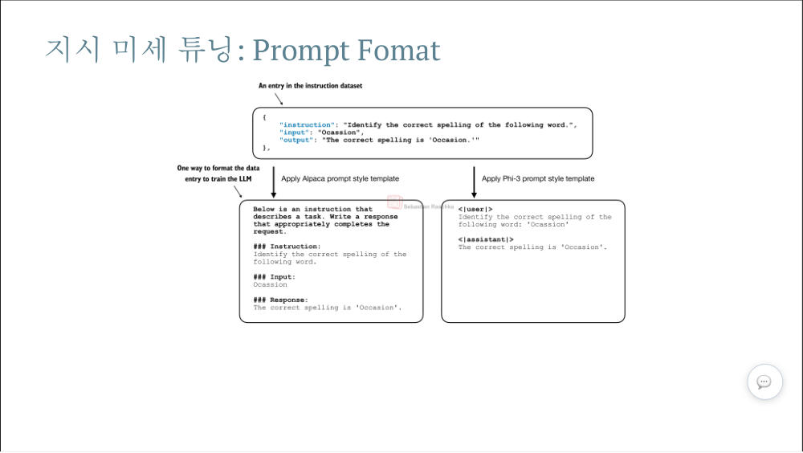

- **배치 구성**
  1. 템플릿 적용 → 토큰화
  2. 배치 내 최장 길이로 `50256` 패딩
  3. 타깃 = 입력을 한 칸 민 것 + 끝에 `50256` 하나 추가
  4. 타깃에서 **첫 번째 50256(EOS)만 남기고** 나머지 패딩은 **-100**으로 교체 → `cross_entropy`가 무시(`ignore_index=-100`). EOS는 남겨야 "언제 멈출지"를 학습함
  5. (선택) Instruction 부분도 -100으로 마스킹해 응답만 학습

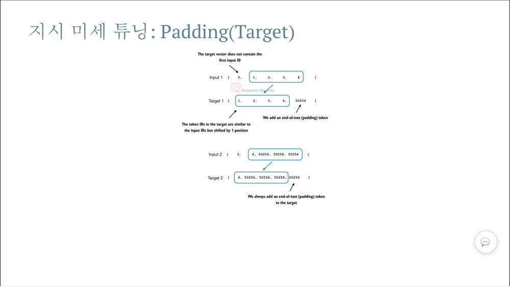
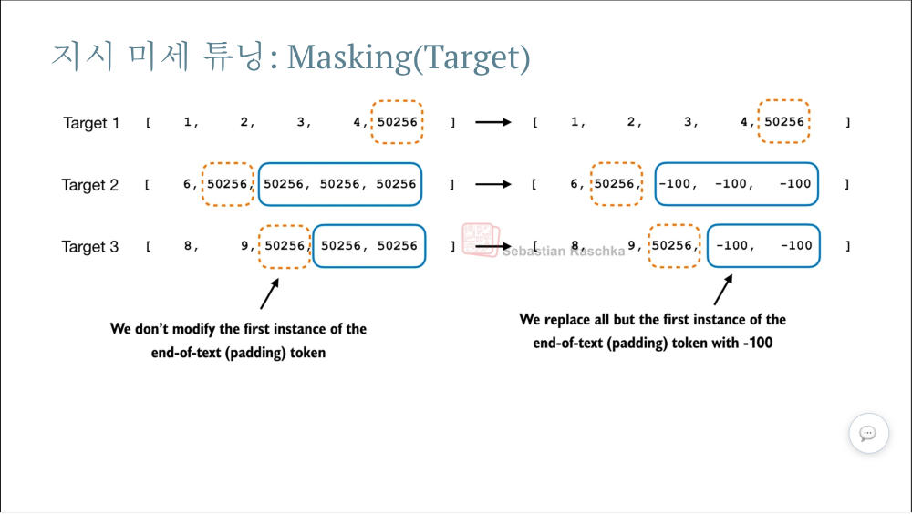
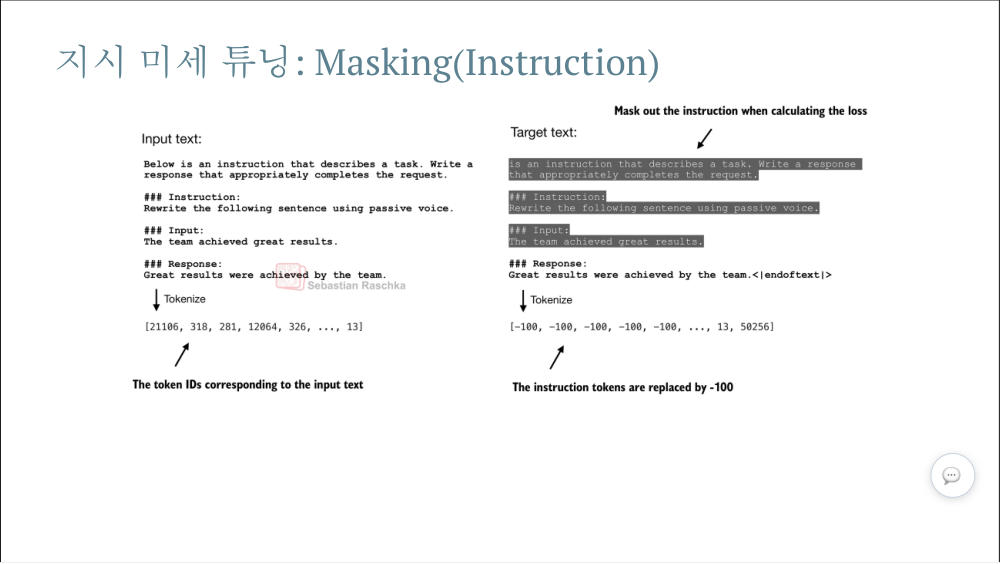

### 쉽게 풀어보기

**사전학습 모델 vs 지시 튜닝 모델**
- 사전학습 모델은 "글 이어 쓰기" 기계라서, 질문을 넣으면 답 대신 비슷한 질문을 계속 이어 쓰기도 합니다(DPO 실습의 reference 모델 출력이 그 예).
- 지시 튜닝은 **"지시 → 모범 답안" 예시 1,100개**를 보여주며, 정해진 템플릿(`### Instruction / ### Response`) 뒤에는 답을 쓰고 멈추도록 길들입니다. 학습 방식 자체는 Ch5와 같은 다음 토큰 예측입니다.

**`custom_collate_fn` 손으로 따라가기** (배치 `[[0,1,2,3,4], [5,6], [7,8,9]]`)
- `batch_max_length` = 가장 긴 길이 5 + 1 = 6
- 두 번째 샘플 `[5, 6]`:
  1. EOS 추가 → `[5, 6, 50256]`
  2. 길이 6까지 패딩 → `[5, 6, 50256, 50256, 50256, 50256]`
  3. 입력 = 앞 5개 `[5, 6, 50256, 50256, 50256]`, 타깃 = 뒤 5개 `[6, 50256, 50256, 50256, 50256]`
  4. 타깃의 50256 위치 = [1, 2, 3, 4] → **첫 번째(1)만 남기고** 나머지를 -100으로 → `[6, 50256, -100, -100, -100]`

**왜 -100인가?**
- `F.cross_entropy`의 기본값 `ignore_index=-100`이라 그 위치는 loss 계산에서 빠집니다. 패딩까지 맞히라고 하면 모델이 "끝에는 50256을 계속 내라"는 쓸데없는 것을 배우고 loss도 왜곡됩니다.
- 첫 번째 50256은 남겨야 "답이 끝나면 **EOS를 내고 멈춘다**"를 배웁니다. 생성할 때 `eos_id=50256`이 나오면 멈추는 것과 짝을 이룹니다.

**`partial`로 고정 인자 넘기기**
- DataLoader는 collate 함수에 배치 하나만 넘깁니다. `partial(custom_collate_fn, device=device, allowed_max_length=1024)`로 나머지 인자를 미리 채워둔 새 함수를 만들어 전달합니다.

### 노트북 구현
```python
def format_input(entry):
    instruction_text = (
        f"Below is an instruction that describes a task. "
        f"Write a response that appropriately completes the request."
        f"\n\n### Instruction:\n{entry['instruction']}"
    )
    input_text = f"\n\n### Input:\n{entry['input']}" if entry["input"] else ""
    return instruction_text + input_text
# InstructionDataset: format_input(entry) + f"\n\n### Response:\n{entry['output']}" 를 토큰화

def custom_collate_fn(batch, pad_token_id=50256, ignore_index=-100,
                      allowed_max_length=None, device="cpu"):
    batch_max_length = max(len(item)+1 for item in batch)
    for item in batch:
        new_item = item.copy()
        new_item += [pad_token_id]                                         # EOS 추가
        padded = new_item + [pad_token_id] * (batch_max_length - len(new_item))
        inputs  = torch.tensor(padded[:-1])
        targets = torch.tensor(padded[1:])
        mask = targets == pad_token_id
        indices = torch.nonzero(mask).squeeze()
        if indices.numel() > 1:
            targets[indices[1:]] = ignore_index                            # 첫 패딩 제외하고 -100
        ...
customized_collate_fn = partial(custom_collate_fn, device=device, allowed_max_length=1024)
```
- 모델: **GPT-2 Medium(355M)**, `lr=5e-5, weight_decay=0.1, epochs=2, batch=8`, 데이터 85/10/5 분할
- 학습 후 테스트셋에 `generate(..., eos_id=50256)`로 응답 생성 → `generated_text[len(input_text):]`로 프롬프트 제거 → JSON 저장

---

## 7+. DPO — `Chapter_7_Exercise_Follow_Instructions_dpo.ipynb`

### 슬라이드 핵심
- 학습 단계: Pre-training → SFT(지시 튜닝) → **RLHF 또는 DPO**(사람 선호 정렬)
- PPO(RLHF)는 별도 Reward Model + 강화학습 필요 → **DPO는 보상 모델 없이 선호 데이터만으로 직접 학습**
- **Bradley-Terry**: 선호 확률 $P(y_w \succ y_l)=\sigma(r_w-r_l)$ — 단순 비율 대신 sigmoid로 양수·확률 보장
- **KL Divergence**: 모델이 원래(reference)에서 급격히 벗어나지 않게 제약
- **DPO Loss**:
  $\mathcal{L}_{DPO}=-\mathbb{E}\left[\log\sigma\left(\beta\log\frac{\pi_\theta(y_w|x)}{\pi_{ref}(y_w|x)}-\beta\log\frac{\pi_\theta(y_l|x)}{\pi_{ref}(y_l|x)}\right)\right]$
  → 좋은 응답 확률은 올리고, 나쁜 응답 확률은 내리되, reference에서 너무 멀어지지 않게. 확률의 곱은 log로 바꿔 합으로 계산
- **데이터셋**: Reward Model용 = (Prompt, Response, Rating) / DPO용 = **(Prompt, Chosen, Rejected)**

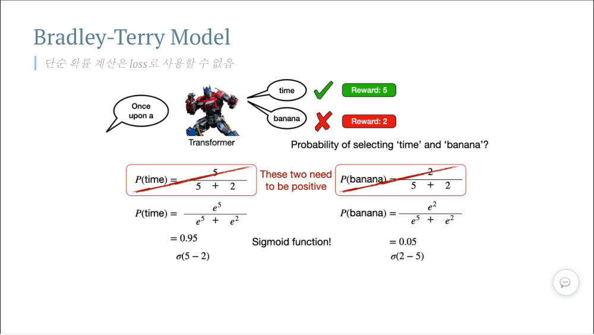
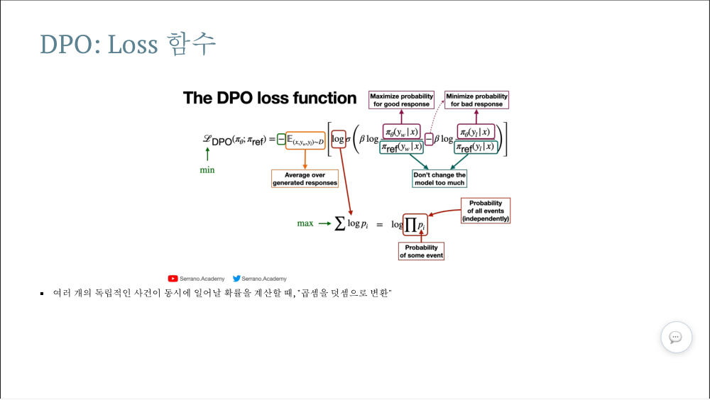

### 쉽게 풀어보기

**DPO = "둘 중 어느 답이 더 좋은지"로 가르치기**
- 지시 튜닝은 "정답 하나"를 보여줍니다. DPO는 같은 질문에 대한 **좋은 답(chosen)과 나쁜 답(rejected)을 나란히** 보여주고 "좋은 쪽 확률은 올리고 나쁜 쪽은 내려라"라고 가르칩니다.
- PPO(RLHF)는 사람 취향을 흉내 내는 채점 모델을 따로 만들고 강화학습을 돌려야 해서 복잡합니다. DPO는 채점 모델 없이 선호 데이터만으로 같은 효과를 냅니다.

**두 모델이 필요한 이유**
- `policy_model`: 학습되는 모델. `reference_model`: 학습 전 상태로 얼려둔 사본.
- loss는 "policy가 reference **보다** 좋은 답을 얼마나 더 선호하게 됐나"로 계산합니다. reference를 기준점으로 두면 모델이 원래 능력에서 너무 멀리 벗어나지 않습니다(KL 제약 역할).

**`compute_logprobs` — "이 답을 그대로 생성할 확률"**
- 답의 각 토큰마다 모델이 정답 토큰에 준 log 확률을 `gather`로 뽑아 평균 냅니다.
- `labels[:, 1:]`과 `logits[:, :-1]`: 위치 t의 출력은 t+1번째 토큰을 예측하므로 한 칸 어긋나게 맞춥니다(Ch2 슬라이딩 윈도우와 같은 원리).
- mask로 프롬프트와 패딩을 제외해 **응답 부분만** 평가합니다.

**Loss 숫자로 보기** (β = 0.1)
- `logits = (policy_chosen − policy_rejected) − (ref_chosen − ref_rejected)`
- 학습 시작: policy = reference → logits = 0 → loss = −log σ(0) = −log 0.5 = **0.693**. 실습 첫 loss 0.694와 일치합니다.
- policy가 chosen 로그확률을 +1, rejected를 −1 움직이면 logits = 2 → −log σ(0.2) ≈ **0.598**로 감소.
- `Margin = chosen reward − rejected reward`가 커질수록 좋은 답을 더 선호하게 됐다는 뜻입니다(실습: −0.018 → 0.288).
- 학습률이 5e-6으로 매우 작은 이유: 크게 바꾸면 말투가 망가지기 쉬워서, 원래 모델 근처에서 조금씩만 조정합니다.

### 노트북 구현
```python
class PreferenceDataset(Dataset):
    # prompt, chosen = prompt + "\n\n### Response:\n" + chosen_response, rejected = ... 를 각각 토큰화
    chosen_full_tokens   = tokenizer.encode(f"{prompt}\n\n### Response:\n{chosen_response}")
    rejected_full_tokens = tokenizer.encode(f"{prompt}\n\n### Response:\n{rejected_response}")

# custom_collate_fn: chosen/rejected를 공통 최장 길이로 패딩, mask 생성
#   패딩 위치 False, mask_prompt_tokens=True면 prompt(+2: "\n\n") 위치도 False → 응답만 loss 계산

def compute_logprobs(logits, labels, selection_mask=None):
    labels = labels[:, 1:].clone()                 # 타깃은 한 칸 앞당김
    logits = logits[:, :-1, :]                     # 마지막 시점 logits 제외
    log_probs = F.log_softmax(logits, dim=-1)
    selected_log_probs = torch.gather(input=log_probs, dim=-1,
                                      index=labels.unsqueeze(-1)).squeeze(-1)  # 정답 토큰 로그확률
    if selection_mask is not None:
        mask = selection_mask[:, 1:].clone()
        selected_log_probs = selected_log_probs * mask
        return selected_log_probs.sum(-1) / mask.sum(-1)    # 유효 토큰 평균
    return selected_log_probs.mean(-1)

def compute_dpo_loss(model_chosen_logprobs, model_rejected_logprobs,
                     reference_chosen_logprobs, reference_rejected_logprobs, beta=0.1):
    model_logratios     = model_chosen_logprobs - model_rejected_logprobs
    reference_logratios = reference_chosen_logprobs - reference_rejected_logprobs
    logits = model_logratios - reference_logratios
    losses = -F.logsigmoid(beta * logits)
    chosen_rewards   = (model_chosen_logprobs - reference_chosen_logprobs).detach()
    rejected_rewards = (model_rejected_logprobs - reference_rejected_logprobs).detach()
    return losses.mean(), chosen_rewards.mean(), rejected_rewards.mean()
```
- **모델 2개**: `policy_model`(학습 대상) + `reference_model`(고정, `eval()` + `torch.no_grad()`로 로그확률만 계산). 둘 다 같은 GPT-2 Medium 가중치에서 시작
- 설정: `beta=0.1, lr=5e-6, weight_decay=0.01, epochs=1, batch=8`
- 결과: 초기 loss ≈ 0.693(= −log σ(0) = ln 2, 두 모델이 같으므로), 학습하며 loss 감소·**Margin(chosen reward − rejected reward)** 증가 (−0.018 → 0.288)

---

## 부록 A. 노트북 빈칸(TODO) 정답 모음

| 노트북 | 빈칸 위치 | 정답 |
|---|---|---|
| Ch2 | 인코딩 / 디코딩 | `tokenizer.encode(...)` / `tokenizer.decode(integers)` |
| Ch2 | next-token 타깃 | `y = enc_sample[1:context_size+1]` |
| Ch2 | 입력 청크 | `token_ids[i : i + max_length]` |
| Ch2 | 타깃 청크 | `token_ids[i + 1 : i + max_length + 1]` |
| Ch2 | `__getitem__` | `return self.input_ids[idx], self.target_ids[idx]` |
| Ch2 | DataLoader 첫 인자 | `dataset` |
| Ch2 | 임베딩 | `nn.Embedding(vocab_size, output_dim)`, `embedding_layer(input_ids)` |
| Ch3 | Q/K/V 투영 | `nn.Linear(d_in, d_out, bias=qkv_bias)` |
| Ch3 | Q/K/V 계산 | `self.W_key(x)`, `self.W_query(x)`, `self.W_value(x)` |
| Ch3 | 어텐션 스코어 | `queries @ keys.transpose(1, 2)` |
| Ch3 | 마스킹 값 | `-torch.inf` |
| Ch3 | 가중치 | `torch.softmax(attn_scores / keys.shape[-1]**0.5, dim=-1)` |
| Ch3 | 컨텍스트 벡터 | `attn_weights @ values` |
| Ch3 | 모듈 호출 | `ca(batch)` |
| Ch4 | LayerNorm | `(x - mean) / torch.sqrt(var + self.eps)`, `self.scale * norm_x + self.shift` |
| Ch4 | FeedForward | `4 * cfg["emb_dim"]`, `GELU()` |
| Ch4 | TransformerBlock | `self.att(x)`, `self.ff(x)` |
| Ch4 | GPTModel 임베딩 | `cfg["vocab_size"]`, `cfg["context_length"]` |
| Ch4 | 출력층 | `nn.Linear(cfg["emb_dim"], cfg["vocab_size"], bias=False)` |
| Ch4 | forward | `tok_embeds + pos_embeds`, `self.trf_blocks(x)`, `self.out_head(x)` |
| Ch4/5 | 생성 루프 | `torch.no_grad()`, `logits[:, -1, :]`, `torch.argmax`, `torch.cat((idx, idx_next), dim=1)` |
| Ch5 | 손실 | `F.cross_entropy(logits.flatten(0, 1), target_batch.flatten())` |
| Ch5 | 학습 루프 | `model.train()`, `optimizer.zero_grad()`, `calc_loss_batch`, `loss.backward()`, `optimizer.step()` |
| Ch5 | 배치 차원 | `.unsqueeze(0)` / `.squeeze(0)` |
| Ch5 | 옵티마이저 | `AdamW(model.parameters(), lr=..., weight_decay=...)` |
| Ch6 | 자르기 / 패딩 | `encoded_text[:self.max_length]`, `[pad_token_id] * (...)` |
| Ch6 | 라벨 컬럼 | `"Label"` |
| Ch6 | 분류 위치 | `model(input_batch)[:, -1, :]` |
| Ch6 | 동결/교체/해제 | `False`, `out_features=num_classes`, `trf_blocks[-1]` + `True`, `final_norm` + `True` |
| LoRA | A / B 크기 | `torch.empty(in_dim, rank)` / `torch.zeros(rank, out_dim)` |
| LoRA | forward | `(self.alpha / self.rank) * (x @ self.A @ self.B)` |
| LoRA | 합산 | `self.linear(x) + self.lora(x)` |
| LoRA | 교체 대상 | `isinstance(module, torch.nn.Linear)` |
| LoRA | main | `requires_grad = False`, `replace_linear_with_lora(model, rank=..., alpha=...)` |
| Ch7 | EOS·패딩 | `new_item += [pad_token_id]`, `[pad_token_id] * (batch_max_length - len(new_item))` |
| Ch7 | 입력/타깃 | `padded[:-1]`, `padded[1:]` |
| Ch7 | 패딩 마스킹 | `targets[indices[1:]] = ignore_index` |
| DPO | 응답 결합 | `{chosen_response}`, `{rejected_response}` |
| DPO | 시프트 | `labels[:, 1:]`, `logits[:, :-1, :]` |
| DPO | gather 입력 | `input=log_probs` |
| DPO | 로그비 | `model_chosen_logprobs - ...`, `reference_chosen_logprobs - ...`, `model_logratios - reference_logratios` |
| DPO | 손실 | `-F.logsigmoid(beta * logits)` |

## 부록 B. 자주 나오는 숫자·규칙

| 항목 | 값 / 규칙 |
|---|---|
| GPT-2 vocab | 50,257 |
| `<\|endoftext\|>` (패딩/EOS) | 50256 |
| CrossEntropy 무시 인덱스 | -100 |
| GPT-2 Small | emb 768 / heads 12 / layers 12 (124M) |
| GPT-2 Medium | emb 1024 / heads 16 / layers 24 (355M) |
| FFN 확장 배수 | 4배 |
| LayerNorm eps | 1e-5, `unbiased=False` |
| 어텐션 스케일 | `/ keys.shape[-1]**0.5` (= √d_k) |
| 인과 마스크 | `torch.triu(ones, diagonal=1)` → `-inf` |
| 분류/생성 시 사용 위치 | 마지막 토큰 `[:, -1, :]` |
| LoRA 초기화 | A 랜덤(kaiming), B 0, 스케일 α/r |
| DPO 초기 loss | ≈ 0.693 (ln 2) |
