# 비전 모델 이해 및 활용 — 실습(ipynb) 구현 범위 요약

## 기초 (모든 노트북 공통)

### 이미지 → 미니배치 텐서 (01_Intro p17)

| 단계 | 내용 | 값 범위 | Shape | PyTorch |
|---|---|---|---|---|
| 1 | RGB 이미지 로드 | 0~255 | (H,W,C) | `PIL.Image.open(...).convert("RGB")` |
| 2–4 | float 변환 → [0,1] 스케일 → 채널 우선 | 0.0~1.0 | **(C,H,W)** | `T.ToTensor()` |
| 5 | 채널별 정규화 | 0 중심 | (C,H,W) | `T.Normalize(mean, std)` |
| 6 | 배치 차원 추가 | | **(B,C,H,W)** | `tensor.unsqueeze(0)` |

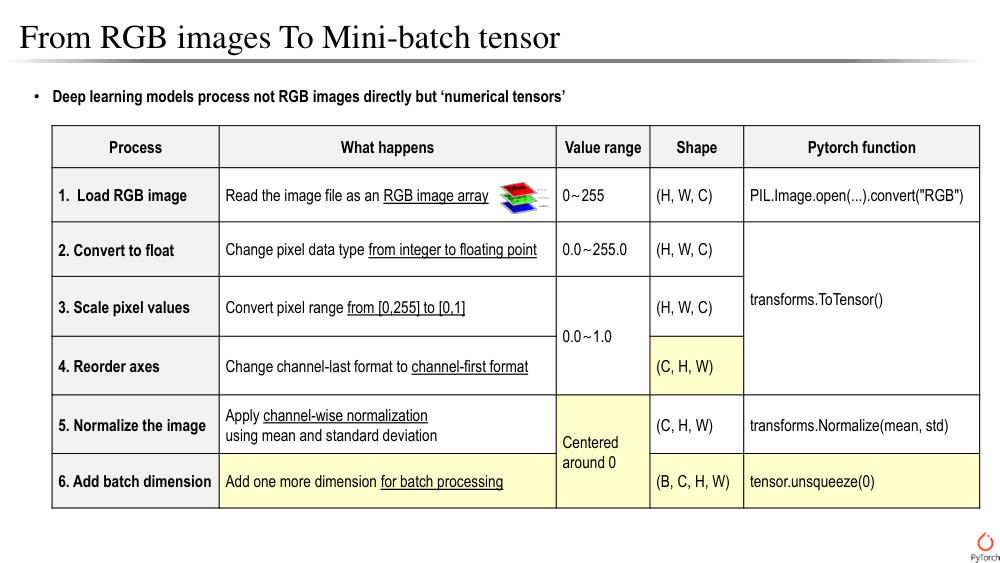

- CIFAR-10(01 p29): 10클래스, 60K장(학습 5만/테스트 1만), **32×32 RGB**
- Epoch/Batch/Iteration(01 p28): iteration 수 = 학습 샘플 수 / batch size → CIFAR-10, batch 256이면 train 196 step, test 40 step
- **Softmax**(02 p8): logits → 확률. 수치 안정화용 Max trick $e^{z_i-m}$, Temperature $T$로 분포 조절
- **분포 ↔ Loss**(02 p11–12): Bernoulli→**BCE**(이진), Categorical→**CE**(다중), Normal→MSE, Laplace→MAE. MLE(우도 최대화) = NLL(음의 로그우도) 최소화

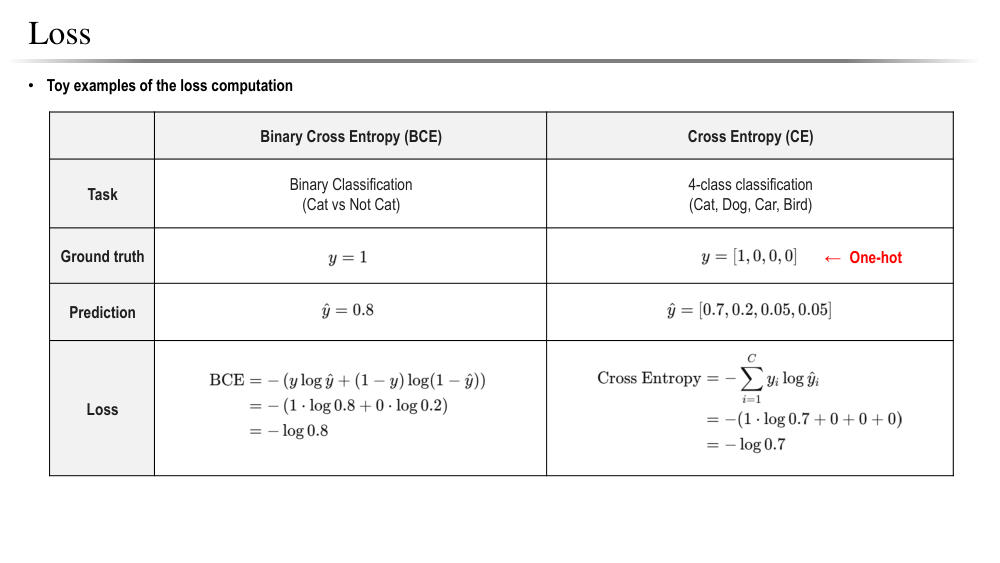

> 코드 연결: ResNet·U-Net은 `nn.CrossEntropyLoss` / `nn.BCEWithLogitsLoss`, ViT는 `F.log_softmax` + `F.nll_loss`(= CrossEntropy와 동일)

### 쉽게 풀어보기

**사진이 숫자 덩어리가 되는 과정**
- 32×32 컬러 사진 = 픽셀 1,024개 × (R, G, B) 3개 = 숫자 3,072개. PIL로 열면 `(높이, 너비, 채널)` = `(32, 32, 3)`, 값은 0~255 정수.
- `ToTensor()`가 한 번에 세 가지를 합니다: 실수로 바꾸고, 255로 나눠 0~1로 만들고, 순서를 PyTorch 규칙인 **채널 우선** `(3, 32, 32)`로 바꿉니다.
- `Normalize(mean, std)`: 채널별로 (x − 평균) / 표준편차 → 대략 −2.4 ~ 2.7 범위의 0 중심 값. 입력 크기가 고르면 기울기도 고르게 흘러 학습이 빠르고 안정적입니다.
- DataLoader가 256장씩 묶으면 `(256, 3, 32, 32)` = **(B, C, H, W)**. 모든 비전 모델 입력은 이 4차원입니다.

**배치·스텝 계산**
- 학습 이미지 50,000장 ÷ 256 = 195.3 → 마지막 자투리 배치 포함 **196 step이 1 epoch**. 테스트는 10,000 ÷ 256 → 40 step.

**어떤 Loss를 쓰나 — 출력의 모양으로 결정**
- "여러 클래스 중 하나"(고양이/개/자동차…) → softmax + **Cross Entropy**. 정답이 개(1번)이고 예측이 [0.7, 0.2, 0.05, 0.05]면 loss = −log 0.7 = 0.36.
- "예/아니오"(이 픽셀이 물체인가) → sigmoid + **BCE**. 정답 1, 예측 0.8이면 loss = −log 0.8 = 0.22.
- `log_softmax` + `nll_loss` = `CrossEntropyLoss`를 두 단계로 나눠 쓴 것일 뿐 결과는 같습니다.

---

## 1. CNN · ResNet — `01_ResNet18_CIFAR10.ipynb`

### 슬라이드 핵심 (02_DNN_CNN)
- **Convolution**(p18): 작은 필터가 이미지를 슬라이딩하며 엣지·텍스처를 추출. 필터 = 학습 파라미터, 결과 = Activation map. 출력 채널 수 = 필터 수
- **왜 Conv인가**(p19): ① 파라미터 공유(FC로 100×100 이미지→1,000 뉴런이면 1천만 개) ② 지역 연결(수용장) ③ 이동 불변성
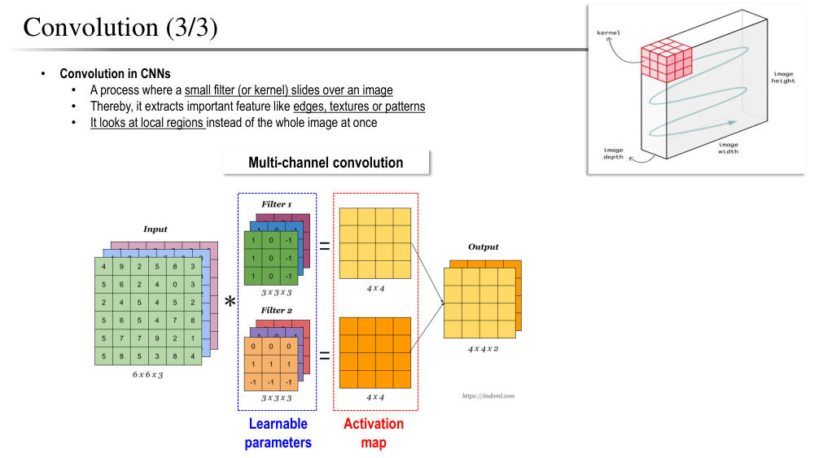

- **Padding/Stride/Pooling**(p20): padding은 크기 유지·가장자리 사용, stride 2는 H·W 절반, pooling은 요약·축소

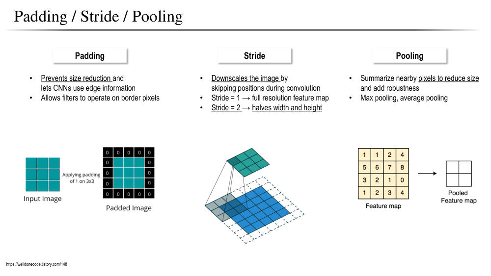

- **Receptive field**(p22): 3×3 두 번 = 5×5 한 번과 같은 수용장, 파라미터는 더 적고(2·3·3 < 5·5) 비선형은 더 많음
- **CNN이 배우는 것**(p32): 초기 층 = 엣지/색, 중간 = 텍스처·부품, 깊은 층 = 객체 형태

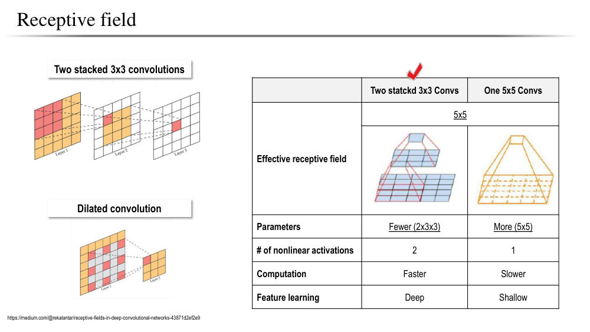
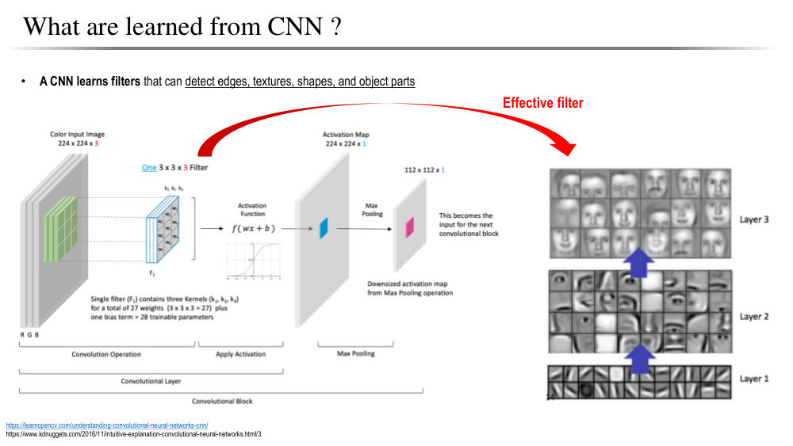

- **ResNet**(p35–41)
  - Degradation 문제: 층을 깊게 쌓으면 **학습 오차조차** 커짐 → 과적합도 기울기 소실도 아닌 "깊은 비선형 망에서 항등 함수 학습이 어려움"
  - **Skip connection**: $H(x)=F(x)+x$. 항등이 최적이면 $W=0$만 배우면 됨 → 0 근처 초기화(He, Xavier)와 궁합이 좋고 Loss landscape가 매끄러워짐
  - 구조: Building block(3×3, 3×3 — ResNet18/34), Bottleneck(1×1↓, 3×3, 1×1↑ — ResNet50+). 각 stage 첫 블록에서 stride 2로 해상도 절반·채널 2배

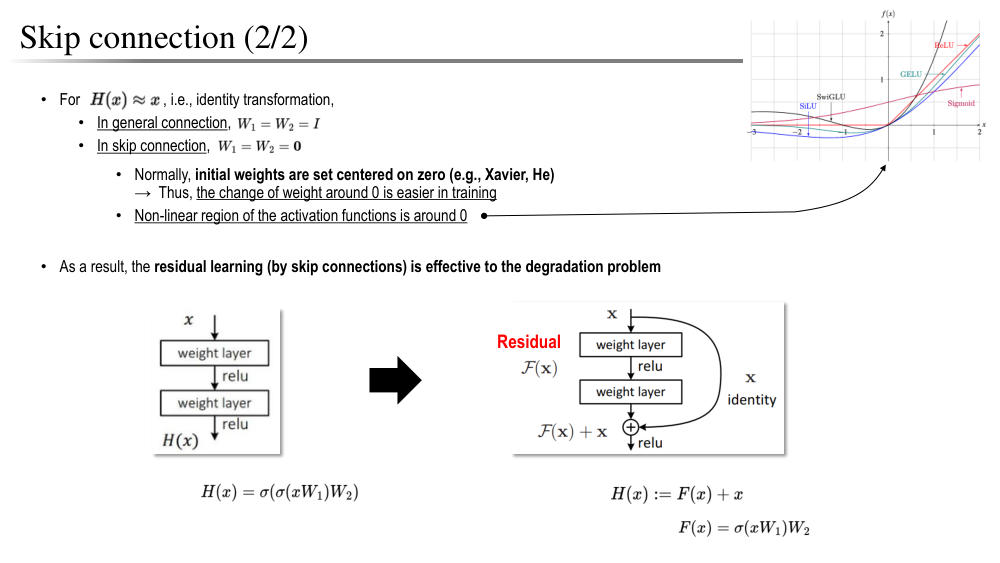
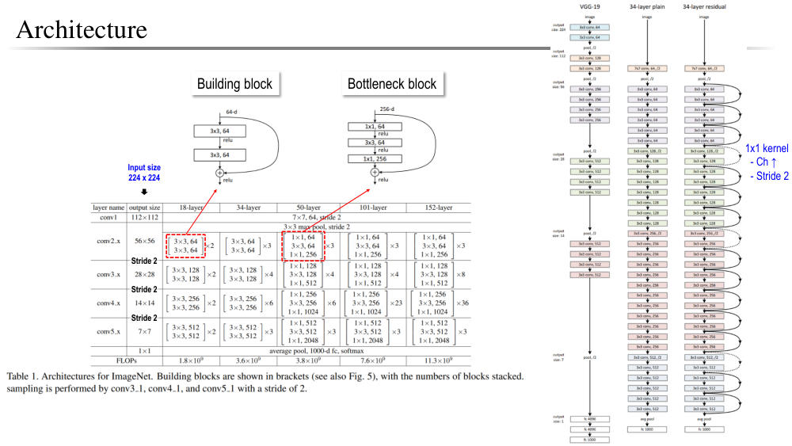

### 쉽게 풀어보기

**합성곱 = 돋보기를 밀며 패턴 찾기**
- 3×3 크기의 작은 필터(돋보기)를 이미지 위에서 한 칸씩 밀면서, 그 자리 9개 픽셀과 필터 값을 곱해 더합니다. 필터가 "세로 엣지 모양"이면 세로 엣지가 있는 곳에서 큰 값이 나옵니다.
- 필터 값은 사람이 정하지 않고 **학습으로 찾습니다**. 필터가 64개면 서로 다른 패턴 64가지를 찾고, 출력 채널도 64개가 됩니다.
- 파라미터 수: RGB(3채널) 입력에 3×3 필터 64개 = 64×3×3×3 = **1,728개**(실습 torchinfo의 첫 conv 파라미터와 같음). 같은 일을 Fully Connected로 하면 수백만 개가 필요합니다 → 같은 필터를 위치마다 재사용(파라미터 공유)하는 덕분입니다.

**출력 크기 공식**: (H + 2·padding − kernel) / stride + 1
- 32×32, 3×3, padding 1, stride 1 → (32+2−3)/1+1 = **32** (크기 유지)
- 같은 조건에 stride 2 → (32+2−3)/2+1 = 16 (절반)

**층이 깊어질수록 넓게 본다 (Receptive field)**
- 3×3 conv 한 번은 3×3 영역을 보지만, 두 번 쌓으면 5×5, 세 번이면 7×7 영역 정보가 섞입니다. stride 2가 끼면 한 칸이 원본의 2칸이 되어 더 빠르게 넓어집니다.
- 그래서 얕은 층은 엣지·색, 깊은 층은 눈·바퀴 같은 부품과 물체 전체를 봅니다(실습의 activation map 비교가 이것을 보여줌).

**ResNet이 해결한 문제 — "더 깊게 쌓았더니 오히려 나빠짐"**
- 20층보다 56층 망이 **학습 데이터에서조차** 오차가 큽니다. 과적합 문제가 아니라, 깊은 망이 "아무것도 안 하는 층(항등 함수)"조차 배우기 어렵다는 최적화 문제입니다.
- 해결: 블록 출력을 `F(x) + x`로 만듭니다. 그러면 블록은 전체 변환 대신 **입력 대비 바뀔 부분 F(x)만** 배우면 됩니다. 아무것도 바꿀 필요가 없으면 F(x)=0, 즉 가중치를 0 근처로 두기만 하면 되는데, 가중치 초기값이 원래 0 근처라 쉽습니다.
- 역전파 때도 `+x` 경로로 기울기가 그대로 흘러 내려가 깊은 층까지 신호가 끊기지 않습니다.

**ResNet18 한눈에**: stem conv → [layer1: 64ch] → [layer2: 128ch, 크기 ½] → [layer3: 256ch, ½] → [layer4: 512ch, ½] → 전역 평균 풀링 → FC(512→클래스 수). 각 layer에 BasicBlock(3×3 conv 두 개 + skip) 2개씩.

### 노트북 구현

**① 전처리 + DataLoader** (`TODO: 직접 작성해보기`)
```python
CIFAR10_MEAN = (0.4914, 0.4822, 0.4465)
CIFAR10_STD  = (0.2023, 0.1994, 0.2010)

train_tfms = T.Compose([
    T.RandomCrop(32, padding=4),       # augmentation
    T.RandomHorizontalFlip(),          # augmentation
    T.ToTensor(),                      # (C,H,W), 0~1
    T.Normalize(CIFAR10_MEAN, CIFAR10_STD),
])
test_tfms = T.Compose([T.ToTensor(), T.Normalize(CIFAR10_MEAN, CIFAR10_STD)])  # 테스트는 증강 없음

train_loader = DataLoader(train_set, batch_size=256, shuffle=True,  num_workers=num_workers, pin_memory=True)
test_loader  = DataLoader(test_set,  batch_size=256, shuffle=False, num_workers=num_workers, pin_memory=True)
```

**② CIFAR(32×32)에 맞게 ResNet18 수정** — ImageNet용 stem(7×7 stride 2 + maxpool)은 32×32에 너무 공격적
```python
model = models.resnet18(weights=None)                         # from scratch
model.conv1   = nn.Conv2d(3, 64, kernel_size=3, stride=1, padding=1, bias=False)  # 7x7/s2 → 3x3/s1
model.maxpool = nn.Identity()                                  # maxpool 제거
model.fc      = nn.Linear(model.fc.in_features, num_classes)   # 512 → 10
```
→ 파라미터 11,173,962개. stage별 출력: layer1 (64,32,32) → layer2 (128,16,16) → layer3 (256,8,8) → layer4 (512,4,4)

> **왜 고쳐야 하나?** 원래 ResNet18은 224×224 사진용이라 시작하자마자 7×7 stride 2 conv(→ ½)와 maxpool(→ ½)로 크기를 1/4로 줄입니다. 32×32에 그대로 쓰면 8×8에서 출발해 layer4에서는 **1×1**까지 줄어 공간 정보가 거의 사라집니다. 3×3 stride 1로 바꾸고 maxpool을 빼면 32×32에서 출발해 layer4가 4×4가 됩니다. `fc`는 ImageNet 1,000클래스용이므로 10클래스로 교체합니다.

**③ 학습 루프 (AMP)**
```python
criterion = nn.CrossEntropyLoss(label_smoothing=0.0)
optimizer = torch.optim.SGD(model.parameters(), lr=0.1, momentum=0.9, weight_decay=5e-4)
scheduler = torch.optim.lr_scheduler.CosineAnnealingLR(optimizer, T_max=epochs_to_run)
scaler = torch.amp.GradScaler(enabled=torch.cuda.is_available())

def train_one_epoch(model, loader, optimizer, criterion):
    model.train()
    for images, labels in loader:
        images = images.to(device, non_blocking=True)
        labels = labels.to(device, non_blocking=True)
        optimizer.zero_grad(set_to_none=True)
        with torch.amp.autocast(device_type=device.type, enabled=torch.cuda.is_available()):
            logits = model(images)
            loss = criterion(logits, labels)
        scaler.scale(loss).backward()    # loss를 키워 FP16 기울기 언더플로 방지
        scaler.step(optimizer)           # unscale 후 업데이트
        scaler.update()

@torch.no_grad()
def evaluate(model, loader, criterion):
    model.eval()                         # Dropout off, BN running stats 고정
    ...
```
> **코드 풀이**
> - **데이터 증강**: `RandomCrop(32, padding=4)`는 사방에 4픽셀 여백을 붙인 뒤 32×32를 랜덤으로 잘라 물체 위치를 살짝 흔들고, `RandomHorizontalFlip`은 50% 확률로 좌우 반전합니다. 매 epoch 조금씩 다른 이미지를 보여줘 외우기(과적합)를 막습니다. 테스트에는 증강을 쓰지 않습니다.
> - **AMP(혼합 정밀도)**: `autocast` 안에서는 계산을 16비트로 해서 빠르고 메모리를 적게 씁니다. 16비트는 아주 작은 기울기를 0으로 만들어버릴 수 있어서, `GradScaler`가 loss에 큰 수를 곱해 역전파한 뒤(`scale`) 업데이트 직전에 다시 나눕니다(`step`). `update`는 다음 번 곱할 배수를 조정합니다.
> - **SGD + momentum 0.9**: 직전 이동 방향을 90% 유지하며 굴러가는 공처럼 업데이트. `weight_decay=5e-4`는 가중치를 조금씩 0 쪽으로 당기는 규제.
> - **CosineAnnealingLR**: 학습률을 처음엔 크게(0.1, 빠르게 탐색) 시작해 코사인 곡선을 따라 0 근처로 줄입니다(끝에서 세밀하게 수렴).
> - **`model.eval()` + `@torch.no_grad()`**: 평가 때 BatchNorm이 배치 통계 대신 학습 중 모아둔 평균·분산을 쓰게 하고, 기울기 계산을 꺼서 빠르게 합니다.
> - `non_blocking=True` + `pin_memory=True`: CPU→GPU 복사를 비동기로 해서 대기 시간을 줄입니다.

- 체크포인트 있으면 +10 epoch, 없으면 20 epoch. val acc가 개선될 때만 `torch.save({'model':..., 'epoch':..., 'val_acc':...})`
- `scheduler.step()`은 epoch마다 호출 → lr이 코사인 곡선으로 0.1 → 0에 가깝게 감소
- 결과: **Best val acc 0.9393**(epoch 60). 클래스별로 cat 0.876이 가장 낮고 automobile 0.975가 가장 높음, 오분류 607개

**④ 추론 / 혼동행렬**
```python
probs = F.softmax(logits, dim=1)
conf, pred = probs.max(dim=1)                 # 신뢰도, 예측 클래스
cm[int(t), int(p)] += 1                       # 행=GT, 열=Pred
per_class_acc = cm.diagonal().float() / cm.sum(dim=1).float()
```

**⑤ Activation map — forward hook**
```python
def capture_activation(model, layer_name, x_single):
    layer = get_module_by_name(model, layer_name)
    activ = {}
    def hook(m, i, o):                     # (module, input, output) — output이 activation map
        activ['feat'] = o.detach().cpu()
    h = layer.register_forward_hook(hook)
    with torch.no_grad():
        _ = model(x_single)
    h.remove()
    return activ['feat'][0]                # (C,H,W)
```
- 커널 시각화: `layer.weight` shape `(O, I, kH, kW)`. `conv1`은 I=3이라 RGB 이미지처럼 볼 수 있고, 깊은 층은 입력 채널 평균으로 표시

**⑥ Grad-CAM** — "어디를 보고 이 클래스라고 했나"
```python
self.h1 = target_layer.register_forward_hook(self._forward_hook)        # activation 저장
self.h2 = target_layer.register_full_backward_hook(self._backward_hook)  # gradient 저장
...
score = logits[:, class_idx].sum(); score.backward()
w   = self.grad.mean(dim=(2,3), keepdim=True)     # 채널별 중요도 = gradient의 공간 평균
cam = (w * self.activ).sum(dim=1, keepdim=True)   # 중요도 가중합
cam = F.relu(cam)                                 # 양의 기여만
cam = (cam - cam.min()) / (cam.max() + 1e-6)      # 0~1 정규화 → 32×32로 bilinear 업샘플 후 overlay
```
- 대상 층은 마지막 conv `layer4.1.conv2`

> **Hook과 Grad-CAM 풀이**
> - **hook**은 모델 코드를 고치지 않고 특정 층에 "도청 장치"를 다는 기능입니다. forward hook은 그 층을 통과한 출력(activation)을, backward hook은 그 층으로 돌아온 기울기를 가로채 저장합니다. 다 쓰면 `remove()`로 떼야 다음 forward에 영향이 없습니다.
> - **Grad-CAM 직관**: 마지막 conv 층의 512개 채널 지도(4×4) 중 "이 클래스 점수를 올리는 데 중요한 채널"에 큰 가중치를 줘서 합칩니다.
>   1. 클래스 점수를 역전파 → 각 채널의 기울기 = "이 채널이 커지면 점수가 얼마나 오르나"
>   2. 기울기를 공간 평균 → 채널별 중요도 w (512개)
>   3. Σ w × 채널 지도 → 4×4 히트맵, ReLU로 점수를 올리는 영역만 남김
>   4. 32×32로 키워 원본에 겹치면 모델이 "어디를 보고" 판단했는지 보입니다.
> - 오분류 샘플에서 히트맵이 물체가 아닌 배경(물·하늘)을 보고 있다면, 모델이 배경으로 판단하는 편향을 배운 것입니다(예: 배 ↔ 비행기 혼동).

**⑦ 추가 실습**
- Receptive field 근사: `rf_new = rf + (k-1)*jump`, `jump_new = jump*s` → 마지막 stage RF **109**, effective stride **8**
- t-SNE: `model.avgpool`에 hook → 512차원 특징을 2D로 축소해 클래스 군집 확인
- `torchinfo.summary`, `torch.onnx.export(..., opset_version=17, dynamic_axes={'input': {0:'B'}, ...})` → Netron에서 구조 비교

---

## 2. Transformer · ViT — `02_ViT_CIFAR10.ipynb`

### 슬라이드 핵심 (03_Attention)
- **Scaled Dot-Product Attention**(p4–7): 임베딩 × $W_Q, W_K, W_V$ → Q, K, V. $\text{softmax}(QK^\top/\sqrt{d_k})V$ = **Value의 가중합**. 모든 토큰이 모든 토큰을 봄(전역 수용장), 어텐션 맵 크기는 $N^2$

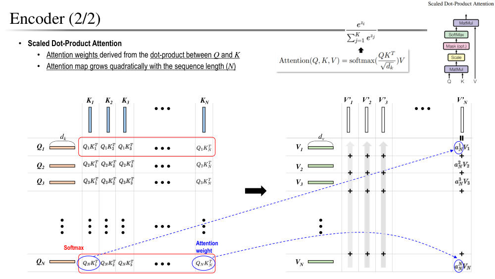

- **ViT 동기**(p9): CNN의 귀납 편향(locality, translation equivariance) 너머로, "self-attention이 convolution을 대체할 수 있나?"
- **구조**(p10–11): 이미지 → 패치 시퀀스 → [CLS] + 위치 임베딩 → Transformer Encoder(L×) → [CLS] 출력 → MLP Head

$$z_0=[x_{class};\,x_p^1E;\cdots;x_p^NE]+E_{pos},\quad z'_\ell=\text{MSA}(\text{LN}(z_{\ell-1}))+z_{\ell-1},\quad z_\ell=\text{MLP}(\text{LN}(z'_\ell))+z'_\ell,\quad y=\text{LN}(z_L^0)$$

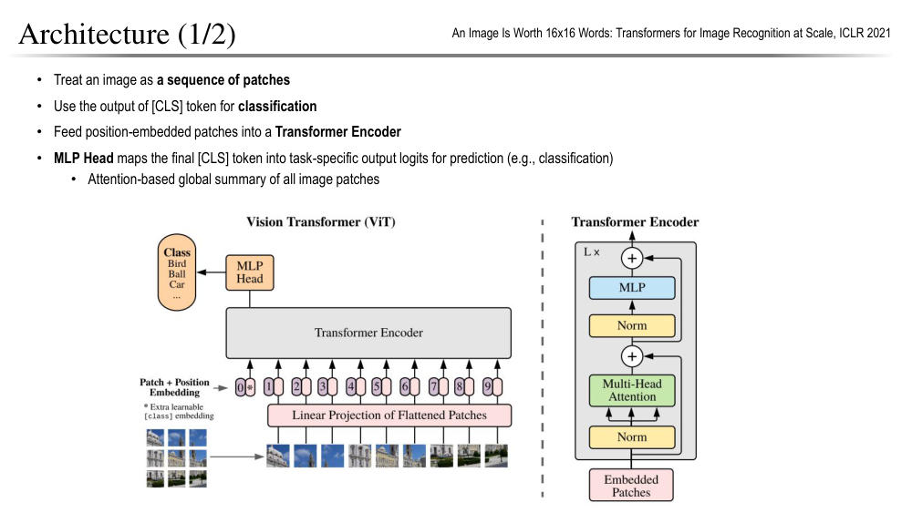
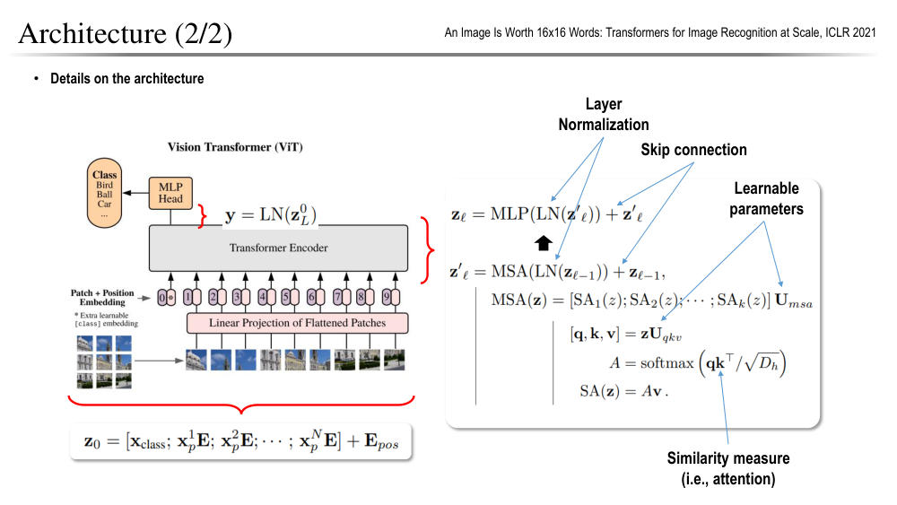

- **단계별 shape**(p12–19)

| 단계 | 연산 | Shape |
|---|---|---|
| 패치 분할 (p12) | $N = HW/P^2$ 개, 패치당 $P^2C$ 픽셀 | $x \in \mathbb{R}^{H\times W\times C} \to x_p \in \mathbb{R}^{N\times P^2C}$ |
| 선형 투영 (p13) | $x_p E$, $E\in\mathbb{R}^{P^2C\times D}$ (학습) | $N\times D$ |
| CLS + 위치 (p14) | CLS를 앞에 **concat**, $E_{pos}$를 **더함**(둘 다 학습) | $(N+1)\times D$ |
| QKV (p15) | $[q,k,v]=zU_{qkv}$ 후 head별 분할 | $(N+1)\times 3D_h$ |
| 어텐션 (p16–17) | $A=\text{softmax}(qk^\top/\sqrt{D_h})$, $SA=Av$ | $A: (N+1)\times(N+1)$ |
| MSA (p18) | head들의 SA concat 후 $U_{msa}$로 투영 | $(N+1)\times D$ |
| 분류 (p19) | CLS 토큰(0번)만 MLP Head로 | $D \to n_{class}$ |

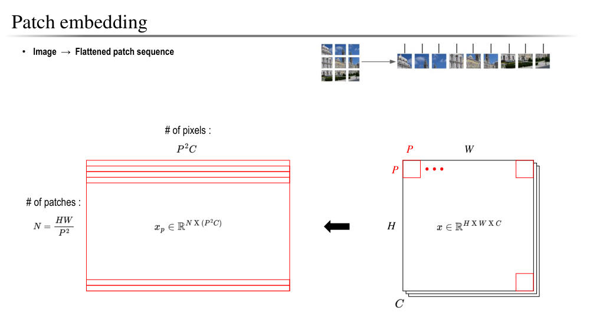
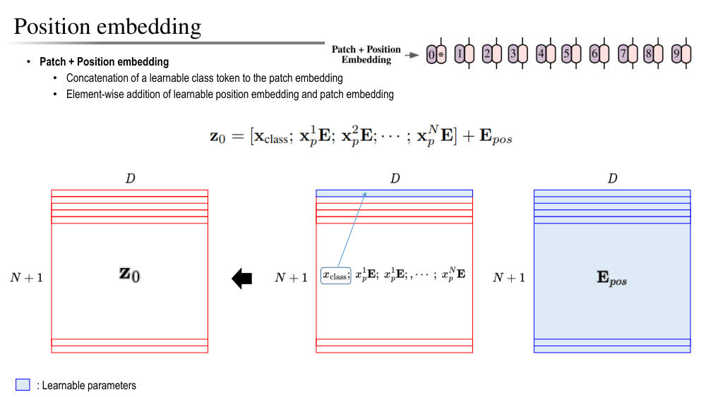
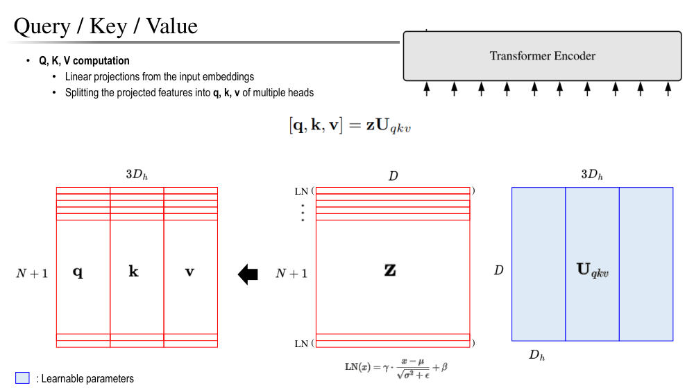
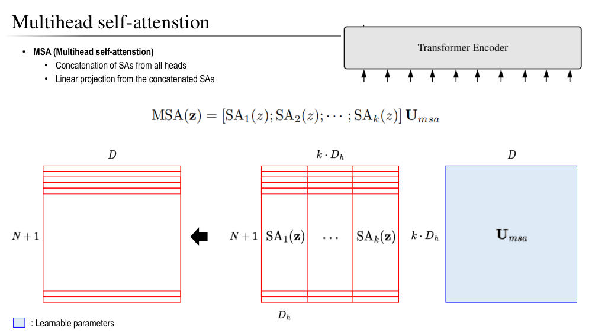
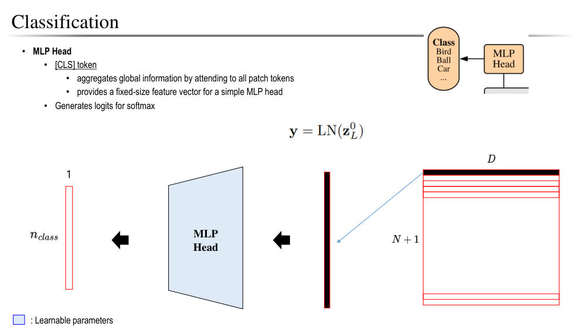

- **실험·한계**(p20–22): 데이터가 커질수록 ViT는 계속 좋아지고 CNN은 포화. 1D 위치 임베딩만으로 2D 공간 정보를 학습. 단점은 **대규모 데이터 필요(작은 데이터에선 과적합)**, 어텐션 비용 **O(N²)**
- 모델 크기: Ti(192/3 head/12층, 5.7M), S(384/6/12, 22M), B(768/12/12, 86M), L(1024/16/24, 307M), H(1280/16/32, 632M)

### 쉽게 풀어보기

**ViT = "이미지를 문장처럼 읽기"**
- 문장을 단어(토큰)로 자르듯, 이미지를 작은 정사각형 **패치**로 자릅니다. 실습에서는 32×32 이미지를 4×4 패치로 잘라 8×8 = **64개 패치**가 됩니다.
- 패치 하나는 4×4 픽셀 × 3채널 = 48개 숫자. 이걸 `Linear(48 → 64)`로 64차원 벡터(= 단어 임베딩 역할)로 바꿉니다.
- 이후는 NLP의 Transformer 인코더와 거의 같습니다. 마스킹이 없으므로 모든 패치가 모든 패치를 볼 수 있습니다(GPT와의 차이).

**[CLS] 토큰 — "반장"**
- 패치 64개 앞에 빈 토큰 하나를 추가합니다. 이 토큰은 이미지 내용이 없는 학습 가능한 벡터인데, 어텐션을 거치며 모든 패치의 정보를 모아 **이미지 전체 요약**이 됩니다. 마지막에 CLS 토큰 하나만 꺼내 분류합니다.
- 대안은 64개 패치 출력을 평균 내는 것(`pool="mean"`)입니다.

**위치 임베딩이 필요한 이유**
- 패치를 섞어도 어텐션 결과가 같으므로, "이 패치가 왼쪽 위인지 오른쪽 아래인지"를 알려줘야 합니다. 65개 자리마다 학습 가능한 벡터를 하나씩 **더합니다**. 1D 번호만 줬는데도 학습 후 비슷한 행·열끼리 비슷해져서 2D 배치를 스스로 익힙니다(p21).

**CNN vs ViT — 귀납 편향의 차이**
- CNN은 "가까운 픽셀끼리 관련 있다(locality)", "같은 패턴은 어디서든 같다"는 가정이 구조에 박혀 있어 **적은 데이터로도 잘 배웁니다**.
- ViT는 이런 가정이 없어 처음부터 관계를 배워야 하므로 데이터가 많이 필요하지만, 데이터가 충분하면 가정에 묶이지 않아 더 높이 올라갑니다.
- 실습 결과가 이를 그대로 보여줍니다: 같은 CIFAR-10(5만 장)에서 ResNet18 **93.9%** vs 작은 ViT **76.5%**.

### 노트북 구현
```python
class PreNorm(nn.Module):                     # Pre-LN: LayerNorm 후 블록 실행
    def __init__(self, dim, fn):
        super().__init__(); self.norm = nn.LayerNorm(dim); self.fn = fn
    def forward(self, x, **kwargs):
        return self.fn(self.norm(x), **kwargs)

class FeedForward(nn.Module):                 # Linear → ReLU → Dropout → Linear → Dropout
    ...

class Attention(nn.Module):
    def __init__(self, dim, heads=4, dim_head=64, dropout=0.):
        super().__init__()
        inner_dim = dim_head * heads
        self.heads = heads
        self.scale = dim_head ** -0.5                          # 1/√d
        self.attend = nn.Softmax(dim=-1)
        self.to_qkv = nn.Linear(dim, inner_dim * 3, bias=False) # Q,K,V를 한 번에
        self.to_out = nn.Sequential(nn.Linear(inner_dim, dim), nn.Dropout(dropout))
    def forward(self, x):
        b, n, _, h = *x.shape, self.heads
        qkv = self.to_qkv(x).chunk(3, dim=-1)
        q, k, v = map(lambda t: rearrange(t, 'b n (h d) -> b h n d', h=h), qkv)
        dots = einsum('b h i d, b h j d -> b h i j', q, k) * self.scale   # QKᵀ/√d
        attn = self.attend(dots)
        self.last_attn = attn.detach()                                     # 시각화용 저장
        out = einsum('b h i j, b h j d -> b h i d', attn, v)               # Av
        out = rearrange(out, 'b h n d -> b n (h d)')                       # head 합치기
        return self.to_out(out)

class Transformer(nn.Module):
    def forward(self, x):
        for attn, ff in self.layers:          # 각 층 = PreNorm(Attention), PreNorm(FFN)
            x = attn(x) + x                   # residual
            x = ff(x) + x                     # residual
        return x

class ViT(nn.Module):
    def __init__(self, cfg):
        ...
        num_patches = (image_height // patch_height) * (image_width // patch_width)
        patch_dim = cfg.channels * patch_height * patch_width
        self.to_patch_embedding = nn.Sequential(
            Rearrange("b c (h p1) (w p2) -> b (h w) (p1 p2 c)", p1=patch_height, p2=patch_width),
            nn.Linear(patch_dim, cfg.dim),
        )
        self.cls_token     = nn.Parameter(torch.randn(1, 1, cfg.dim))
        self.pos_embedding = nn.Parameter(torch.randn(1, num_patches + 1, cfg.dim))
        self.mlp_head = nn.Sequential(nn.LayerNorm(cfg.dim), nn.Linear(cfg.dim, cfg.num_classes))

    def forward(self, img):
        x = self.to_patch_embedding(img)                        # (B,N,dim)
        b, n, _ = x.shape
        cls_tokens = repeat(self.cls_token, "1 1 d -> b 1 d", b=b)
        x = torch.cat((cls_tokens, x), dim=1)                   # (B,N+1,dim)
        x = x + self.pos_embedding[:, : (n + 1)]                # broadcasting
        x = self.dropout(x)
        x = self.transformer(x)
        x = x[:, 0] if self.pool == "cls" else x.mean(dim=1)    # CLS 또는 mean pool
        return self.mlp_head(x)
```
**Shape 흐름 (배치 B, 실습 설정)**

| 단계 | 코드 | Shape |
|---|---|---|
| 입력 이미지 | `img` | `(B, 3, 32, 32)` |
| 패치로 펼치기 | `Rearrange(...)` | `(B, 64, 48)` — 64패치 × (4·4·3) |
| 패치 임베딩 | `Linear(48, 64)` | `(B, 64, 64)` |
| CLS 붙이기 | `torch.cat((cls, x), dim=1)` | `(B, 65, 64)` |
| 위치 임베딩 더하기 | `x + pos_embedding` | `(B, 65, 64)` |
| Q,K,V 한 번에 | `to_qkv` (64 → 256×3) | `(B, 65, 768)` → `chunk(3)` → 각 `(B, 65, 256)` |
| head로 나누기 | `'b n (h d) -> b h n d'` | `(B, 4, 65, 64)` |
| 어텐션 점수 | `einsum(q, k) * scale` | `(B, 4, 65, 65)` |
| 가중합 | `einsum(attn, v)` | `(B, 4, 65, 64)` |
| head 합치기 + 투영 | `'b h n d -> b n (h d)'`, `to_out` | `(B, 65, 256)` → `(B, 65, 64)` |
| 6층 통과 후 CLS | `x[:, 0]` | `(B, 64)` |
| 분류 | `mlp_head` | `(B, 10)` |

> - `einsum('b h i d, b h j d -> b h i j', q, k)`는 `q @ k.transpose(-1, -2)`와 같습니다. 문자로 축 이름을 붙여 "d 축끼리 곱해 더해라"라고 적는 표기입니다.
> - `rearrange`(einops)는 `view` + `permute`를 문자열 하나로 쓰는 도구입니다. `(h d)`는 "h와 d를 합친 축"이라는 뜻입니다.
> - Pre-LN 구조: `PreNorm`이 LayerNorm을 먼저 하고 Attention/FFN을 실행, 바깥에서 `+ x`(residual)를 합니다. LLM의 GPT 블록과 같은 패턴입니다.

- 설정: `image_size=32, patch_size=4`(→ (32/4)² = **64 패치 + CLS = 65 토큰**), `dim=64, depth=6, heads=4, dim_head=64, mlp_dim=128` → 파라미터 **502,730개**
- 학습: `optim.Adam(lr=0.003)`, `output = F.log_softmax(model(data), dim=1)` + `F.nll_loss(output, target)`. test acc가 개선될 때만 ckpt 저장
- 결과: epoch 40에서 **test acc 76.51%** (같은 데이터로 ResNet18 93.9% → 작은 데이터에서 ViT가 불리하다는 슬라이드 p22 내용과 일치)
- CLS attention 시각화: 마지막 층 `attn[0, head, 0, 1:]`(CLS→패치) → 8×8로 reshape → 32×32로 bilinear 업샘플 후 원본 위에 overlay. head 평균과 head별로 비교
- 혼동행렬(`sklearn.metrics.confusion_matrix` + seaborn), 오분류 샘플(`preds.ne(target)`), ONNX export

---

## 3. Object Detection · DETR — `03_DETR.ipynb`

### 슬라이드 핵심 (04_Applications)
- **Detection**(p3): What(분류 → class + confidence) + Where(위치 → bounding box)
- **IoU**(p6): $\text{IoU}=|B_{pred}\cap B_{gt}|/|B_{pred}\cup B_{gt}|$. TP = 클래스 맞음 & IoU ≥ 임계값 & 1:1 매칭(p7). AP = PR 곡선 아래 면적, mAP = 클래스 평균, COCO는 AP@[.50:.05:.95]

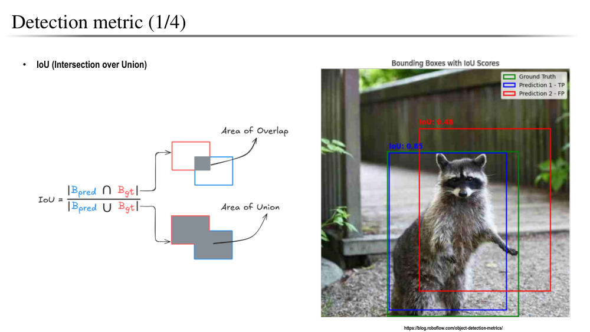

- **DETR 동기**(p27–28): 기존 검출기는 손으로 만든 anchor, NMS 후처리, RPN/FPN 같은 다단계 구성에 의존 → **Transformer로 완전한 end-to-end 집합(set) 예측**
- **구조**(p29–30): CNN(ResNet-50) → 1×1 conv로 채널 축소 & flatten → Transformer Encoder(전역 관계) → Decoder(**Object query** N개 = 학습 가능한 "가능한 객체" 임베딩) → FFN이 class·box 예측
  - $x_{img}\in\mathbb{R}^{3\times H_0\times W_0} \to f\in\mathbb{R}^{2048\times H_0/32\times W_0/32} \to z_0\in\mathbb{R}^{d\times hw}$, 출력 $p(c)\in\mathbb{R}^{N\times(c+1)}$, $\hat b\in\mathbb{R}^{N\times 4}$

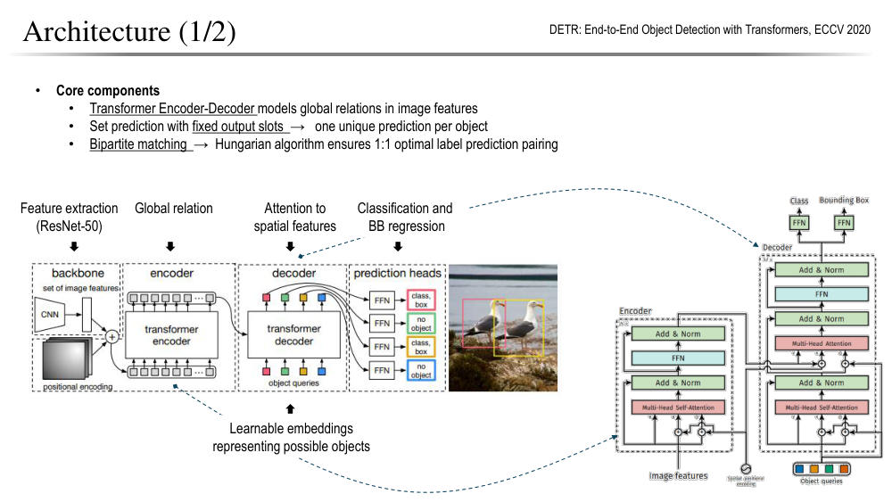
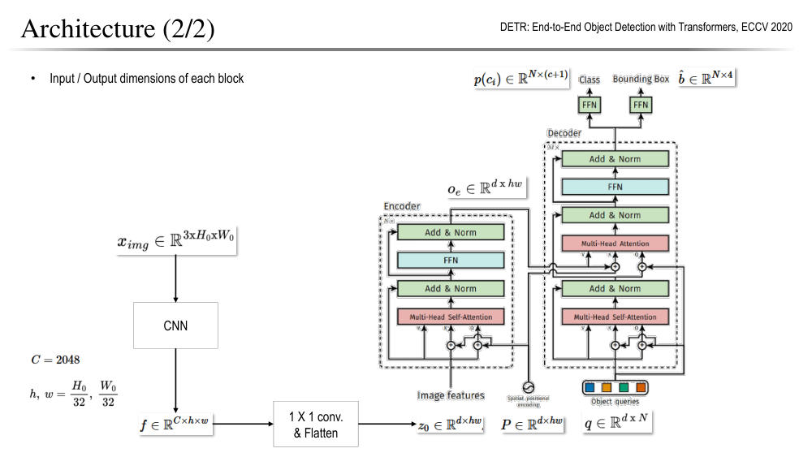

- **Loss**(p31–33): ① 예측 N개와 GT를 **Hungarian 알고리즘으로 1:1 이분 매칭**(클래스 확률 + 박스 거리) ② 매칭된 쌍에 대해 Hungarian loss = $-\log\hat p(c)$ + 박스 loss($\lambda_{iou}\mathcal{L}_{GIoU}+\lambda_{L1}\|b-\hat b\|_1$). 매칭 안 된 예측은 "no object"(∅) → **NMS 불필요**
  - GIoU = IoU − |C∖(A∪B)|/|C| (C: 둘을 감싸는 최소 박스). 겹치지 않아도 거리를 반영, $-1<\text{GIoU}<1$, $\text{Loss}=1-\text{GIoU}$
- **실험**(p34): Encoder self-attention은 개별 인스턴스를 분리, Decoder attention은 **객체의 끝부분(다리·머리)**에 집중

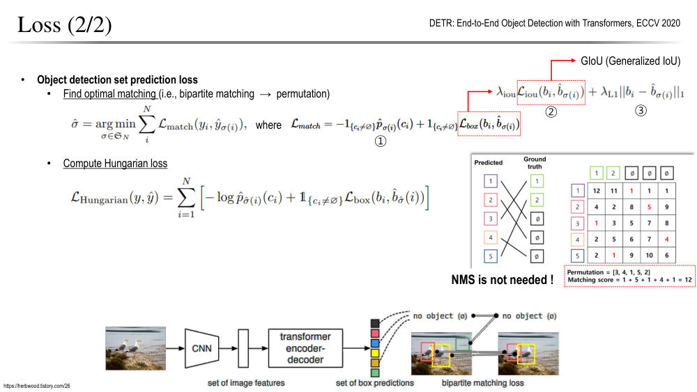
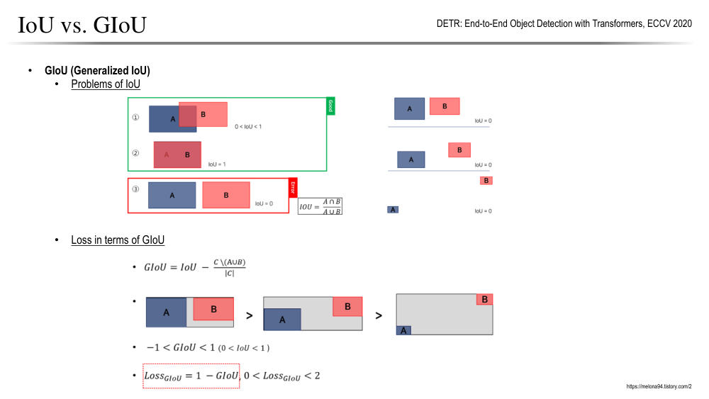
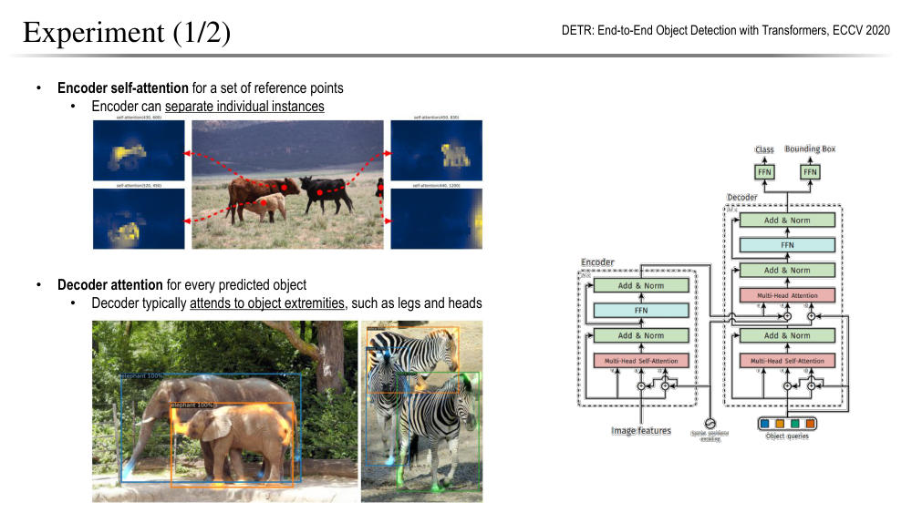

### 쉽게 풀어보기

**기존 검출기의 불편함**
- 이미지 곳곳에 미리 정한 크기의 상자(anchor)를 수천 개 깔고, 각각 "물체 있나? 상자를 얼마나 고칠까?"를 예측합니다. 그러면 한 고양이에 상자가 수십 개 겹쳐 나와서, **NMS**(가장 점수 높은 것만 남기고 겹치는 건 지우기)라는 후처리가 꼭 필요합니다.

**DETR = "자리 100개짜리 답안지"**
- DETR은 처음부터 **답 칸 100개(object query)**를 준비합니다. 각 칸은 "물체 하나를 맡을 담당자"이고, 모델은 칸마다 (클래스, 상자)를 하나씩 적습니다. 물체가 5개면 5칸만 물체를 적고 나머지 95칸은 "**no object**"라고 적습니다.
- 그래서 `pred_logits`의 마지막 차원이 91(COCO 클래스 슬롯) + 1(no object) = **92**입니다.

**학습 때 "어느 칸이 어느 정답이냐"를 정하는 법 — Hungarian 매칭**
- 예측 100칸과 정답 물체 5개를 **1:1로 짝짓는** 모든 방법 중, "클래스가 잘 맞고 상자가 가까운" 총비용이 가장 작은 조합을 고릅니다(슬라이드의 의자 앉히기 그림).
- 짝이 정해지면 그 칸들만 정답 클래스·상자로 loss를 받고, 나머지 칸은 "no object"를 맞히도록 학습합니다. 정답 하나에 칸 하나만 배정되므로 중복 상자가 생길 이유가 없고 **NMS가 필요 없습니다**.

**GIoU가 필요한 이유**
- 두 상자가 전혀 안 겹치면 IoU는 멀리 떨어져 있든 가깝든 똑같이 0 → 어느 쪽으로 움직여야 할지 기울기가 없습니다.
- GIoU는 두 상자를 감싸는 최소 상자 C에서 빈 공간 비율을 빼서, 떨어진 거리까지 반영합니다(멀수록 −1에 가까움).

**Encoder와 Decoder가 하는 일**
- CNN이 이미지를 25×34 격자 특징으로 줄이면, 각 칸이 토큰 하나(850개)가 됩니다.
- **Encoder self-attention**: 850개 칸끼리 서로 보며 "같은 물체에 속한 칸"을 묶습니다 → 한 소 위의 점을 고르면 그 소 전체가 밝아짐(인스턴스 분리).
- **Decoder cross-attention**: 각 query가 850칸 중 자기 물체 쪽을 봅니다. 위치는 Encoder가 이미 잡아서, Decoder는 **경계를 정하는 데 필요한 끝부분(다리, 머리, 꼬리)**에 집중합니다.

### 노트북 구현 (학습 없이 사전학습 모델로 추론·분석)
```python
torch.set_grad_enabled(False)                       # 추론 전용

transform = T.Compose([
    T.Resize(800),                                  # 짧은 변 800
    T.ToTensor(),
    T.Normalize([0.485, 0.456, 0.406], [0.229, 0.224, 0.225]),  # ImageNet mean/std
])

def box_cxcywh_to_xyxy(x):                          # (cx,cy,w,h) → (x1,y1,x2,y2)
    x_c, y_c, w, h = x.unbind(1)
    b = [(x_c - 0.5*w), (y_c - 0.5*h), (x_c + 0.5*w), (y_c + 0.5*h)]
    return torch.stack(b, dim=1)

def rescale_bboxes(out_bbox, size):                 # 0~1 정규화 → 픽셀 좌표
    img_w, img_h = size
    b = box_cxcywh_to_xyxy(out_bbox)
    return b * torch.tensor([img_w, img_h, img_w, img_h], dtype=torch.float32)

model = torch.hub.load('facebookresearch/detr', 'detr_resnet50', pretrained=True)
model.eval()

img = transform(im).unsqueeze(0)                    # (1,3,800,1066)
outputs = model(img)
# outputs['pred_logits']: (1, 100, 92)  ← 100 object queries, 91 COCO 슬롯 + 1 no-object
# outputs['pred_boxes'] : (1, 100, 4)   ← 정규화된 (cx,cy,w,h)

probas = outputs['pred_logits'].softmax(-1)[0, :, :-1]   # 마지막(no-object) 제외
keep = probas.max(-1).values > 0.9                       # 신뢰도 0.9 초과만
bboxes_scaled = rescale_bboxes(outputs['pred_boxes'][0, keep], im.size)   # → (5, 4)
```
> **코드 풀이**
> - `softmax(-1)[0, :, :-1]`: 92개 클래스 확률 중 마지막(no object)을 빼고 91개만 봅니다. 그 중 최댓값이 0.9를 넘는 query만 "물체 있음"으로 채택합니다. 실습 고양이 사진에서는 100개 중 **5개**가 남습니다.
> - 박스 변환 예시: 640×480 이미지에서 예측 (cx, cy, w, h) = (0.5, 0.5, 0.2, 0.4)
>   → xyxy = (0.4, 0.3, 0.6, 0.7) → × [640, 480, 640, 480] = **(256, 144, 384, 336)** 픽셀.
> - `T.Resize(800)`은 짧은 변을 800으로 맞춥니다(640×480 → 1066×800). 박스는 0~1 비율이라 원본 크기(`im.size`)를 곱하면 바로 원본 좌표가 됩니다.
> - 전처리를 ImageNet mean/std로 하는 이유: backbone인 ResNet-50이 ImageNet으로 사전학습되어 그 분포에 맞춰져 있기 때문입니다.

- COCO 클래스 테이블 91개 중 실제 80개(나머지 `N/A`). 파라미터 41.5M
- **Attention hook** — 시각화용 텐서 3종 캡처
```python
hooks = [
    model.backbone[-2].register_forward_hook(
        lambda self, input, output: conv_features.append(output)),
    model.transformer.encoder.layers[-1].self_attn.register_forward_hook(
        lambda self, input, output: enc_attn_weights.append(output[1])),     # output[1] = attention weight
    model.transformer.decoder.layers[-1].multihead_attn.register_forward_hook(
        lambda self, input, output: dec_attn_weights.append(output[1])),
]
outputs = model(img)
for hook in hooks: hook.remove()
```

| 텐서 | Shape | 의미 |
|---|---|---|
| backbone feature | (1, 2048, 25, 34) | 800×1066 입력 ÷ 32 |
| encoder self-attn | (1, 850, 850) | 850 = 25×34 픽셀 토큰끼리 |
| decoder cross-attn | (1, 100, 850) | 100 query가 850 위치를 보는 정도 |

- Decoder cross-attention: `dec_attn_weights[0, idx].view(h, w)` → 검출된 query별로 어디를 보는지(객체 외곽)
- Encoder self-attention: `enc_attn_weights[0].reshape(shape + shape)` → (25,34,25,34). 원본 좌표 (y,x)를 `fact=32`로 나눠 토큰 좌표로 바꾼 뒤 `sattn[..., y//32, x//32]`를 heatmap으로 표시. `AttentionVisualizer`로 슬라이더 인터랙티브 버전 제공

---

## 4. Segmentation · U-Net — `04_Unet.ipynb`

### 슬라이드 핵심
- **Segmentation**(04 p63): **픽셀 단위 분류**. 출력 shape = (클래스, H, W)
- **지표**(p65): 클래스별 IoU, **mIoU**(클래스 평균, 가장 많이 씀), FWIoU(빈도 가중)

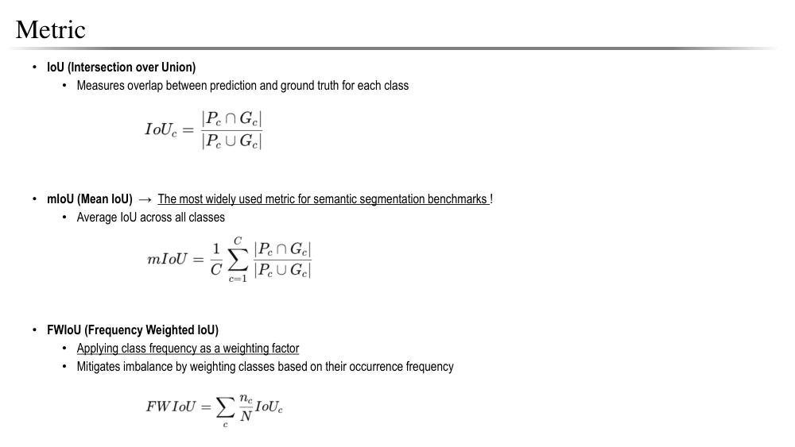

- **U-Net**(p81): Fully Convolutional
  - **Contracting path**: 크기↓ 채널↑ → 문맥(context) 추출
  - **Expanding path**: 크기↑ 채널↓ → 정확한 위치(localization)
  - **Skip connection**: 같은 해상도의 인코더 특징을 crop & **concatenate** → 다운샘플링 중 잃은 공간 정보 복원
  - 원 논문은 padding 없는 valid conv라 출력이 입력보다 작음(572 → 388)
- **Transposed convolution**(p82, 02 p26): 학습 가능한 업샘플링. 입력 값마다 필터를 곱해 겹치는 곳은 더함(체커보드 아티팩트 주의)
- **학습**(p83–84): 라벨링 비용이 커서 데이터가 적음 → Overlap-tile, Elastic 변형 증강. Loss에 클래스 빈도 균형 가중치 + 경계 픽셀 강조 가중치 $w(x)$

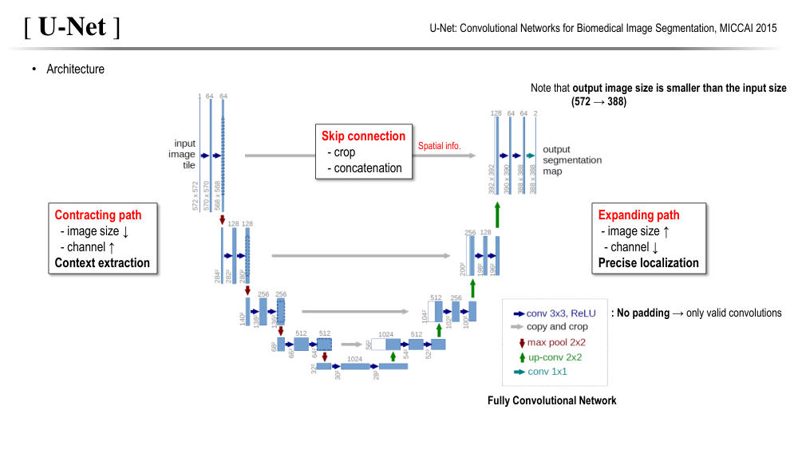
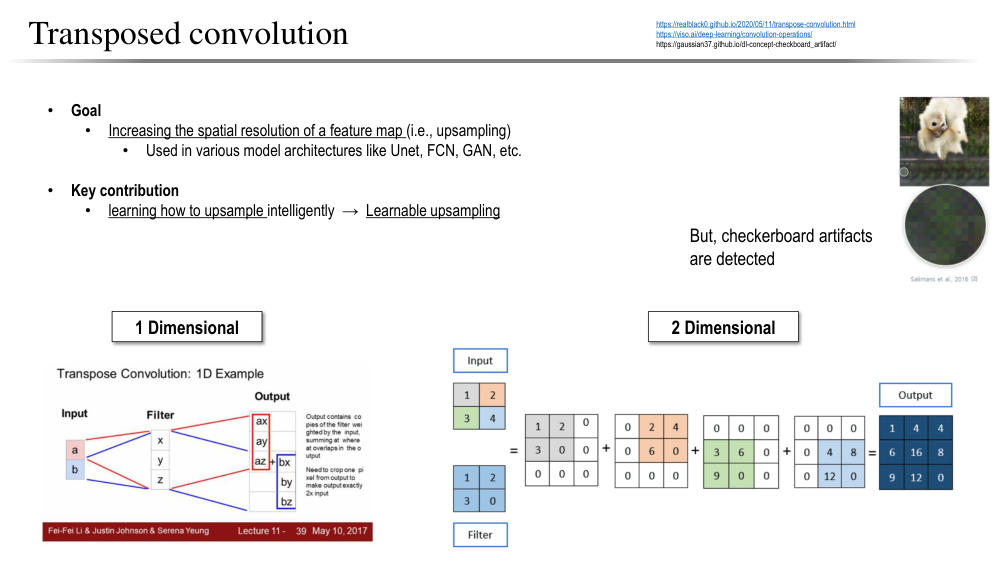

### 쉽게 풀어보기

**분류 → 검출 → 분할**
- 분류: "이 사진은 고양이" (답 1개). 검출: "고양이가 이 상자 안에" (상자 몇 개). 분할: "**이 픽셀들이** 고양이" (픽셀마다 답).
- 그래서 분할 모델의 출력은 입력과 같은 크기의 지도 `(클래스 수, H, W)`입니다. 실습은 "원이냐 아니냐" 이진 분할이라 `(1, 128, 128)`.

**U-Net = 줄였다가 다시 키우는 U자 모양**
- **왼쪽(인코더, 내려가는 길)**: conv + maxpool로 크기는 절반씩 줄이고 채널은 두 배씩 늘립니다. 무엇이 있는지(문맥)는 잘 알게 되지만, 정확한 위치는 흐려집니다.
- **오른쪽(디코더, 올라가는 길)**: 업샘플로 크기를 다시 두 배씩 키웁니다. 하지만 작게 줄였던 지도를 키우기만 하면 경계가 뭉개집니다.
- **Skip connection(가운데 다리)**: 같은 크기의 인코더 특징(세밀한 위치 정보)을 디코더 쪽에 그대로 **이어 붙여(concat)** 줍니다. "무엇"은 아래에서, "어디"는 옆에서 받아 둘을 합칩니다.
- ResNet의 skip은 **더하기**(크기 유지), U-Net의 skip은 **채널 방향 이어 붙이기**(채널 수가 늘어남)라는 점이 다릅니다.

**Transposed conv = 학습하는 확대**
- 입력 값 하나하나에 필터 전체를 곱해 출력에 "도장 찍듯" 펼치고, 겹치는 곳은 더합니다. `kernel_size=2, stride=2`면 겹침 없이 정확히 2배 크기가 됩니다. 단순 보간(bilinear)과 달리 확대 방식을 학습합니다.

**Loss — BCEWithLogitsLoss**
- 픽셀마다 "물체일 확률"을 이진 분류합니다. 마지막 층은 sigmoid 없이 원시 점수(logit)를 내고, `BCEWithLogitsLoss`가 내부에서 sigmoid + BCE를 함께 계산합니다(따로 하는 것보다 수치적으로 안정).
- 추론 때는 직접 `sigmoid`를 씌워 0.5를 기준으로 0/1 마스크를 만듭니다.

### 노트북 구현
```python
class DoubleConv(nn.Module):        # (Conv3x3 → ReLU) × 2, padding=1이라 H,W 유지
    def __init__(self, in_channels, out_channels, mid_channels=None):
        super().__init__()
        if mid_channels is None: mid_channels = out_channels
        self.net = nn.Sequential(
            nn.Conv2d(in_channels, mid_channels, kernel_size=3, padding=1, bias=False), nn.ReLU(inplace=True),
            nn.Conv2d(mid_channels, out_channels, kernel_size=3, padding=1, bias=False), nn.ReLU(inplace=True),
        )

class Down(nn.Module):              # MaxPool2d(2)로 H,W 절반 → DoubleConv로 채널 확장
    def forward(self, x):
        return self.conv(self.pool(x))

class Up(nn.Module):                # 업샘플 → 크기 맞춤 pad → skip concat → DoubleConv
    def __init__(self, in_channels, out_channels, bilinear=False):
        super().__init__()
        if bilinear:
            self.up = nn.Upsample(scale_factor=2, mode="bilinear", align_corners=True)
            self.conv = DoubleConv(in_channels, out_channels, mid_channels=in_channels // 2)
        else:
            self.up = nn.ConvTranspose2d(in_channels, in_channels // 2, kernel_size=2, stride=2)  # 크기 2배, 채널 절반
            self.conv = DoubleConv(in_channels, out_channels)
    def forward(self, x1, x2):      # x1: 디코더(작은 해상도), x2: skip(인코더)
        x1 = self.up(x1)
        diff_y = x2.size(2) - x1.size(2); diff_x = x2.size(3) - x1.size(3)
        x1 = F.pad(x1, [diff_x // 2, diff_x - diff_x // 2, diff_y // 2, diff_y - diff_y // 2])
        x = torch.cat([x2, x1], dim=1)          # 채널 축(dim=1)으로 concat
        return self.conv(x)

class OutConv(nn.Module):           # 1×1 conv: 채널 → 클래스 수
    ...

class UNet(nn.Module):
    def __init__(self, n_channels, n_classes, bilinear=False):
        super().__init__()
        self.inc   = DoubleConv(n_channels, 64)     # (B,64,H,W)
        self.down1 = Down(64, 128)                   # H/2
        self.down2 = Down(128, 256)                  # H/4
        self.down3 = Down(256, 512)                  # H/8
        factor = 2 if bilinear else 1
        self.down4 = Down(512, 1024 // factor)       # H/16 (bottleneck)
        self.up1 = Up(1024, 512 // factor, bilinear) # in_channels = concat 이후 채널
        self.up2 = Up(512, 256 // factor, bilinear)
        self.up3 = Up(256, 128 // factor, bilinear)
        self.up4 = Up(128, 64, bilinear)
        self.outc = OutConv(64, n_classes)
    def forward(self, x):
        x1 = self.inc(x); x2 = self.down1(x1); x3 = self.down2(x2); x4 = self.down3(x3); x5 = self.down4(x4)
        x = self.up1(x5, x4); x = self.up2(x, x3); x = self.up3(x, x2); x = self.up4(x, x1)
        return self.outc(x)                          # (B, n_classes, H, W) logits
```
**Shape 흐름 (입력 `(1, 1, 128, 128)`, bilinear=False)**

| 단계 | 연산 | 출력 Shape |
|---|---|---|
| `inc` | DoubleConv(1→64) | `(1, 64, 128, 128)` = x1 |
| `down1` | MaxPool → DoubleConv(64→128) | `(1, 128, 64, 64)` = x2 |
| `down2` | → 256 | `(1, 256, 32, 32)` = x3 |
| `down3` | → 512 | `(1, 512, 16, 16)` = x4 |
| `down4` | → 1024 (bottleneck) | `(1, 1024, 8, 8)` = x5 |
| `up1` | ConvT(1024→512) `(512,16,16)` + concat x4(512) = 1024ch → DoubleConv → 512 | `(1, 512, 16, 16)` |
| `up2` | ConvT(512→256) + concat x3(256) = 512ch → 256 | `(1, 256, 32, 32)` |
| `up3` | ConvT(256→128) + concat x2(128) = 256ch → 128 | `(1, 128, 64, 64)` |
| `up4` | ConvT(128→64) + concat x1(64) = 128ch → 64 | `(1, 64, 128, 128)` |
| `outc` | 1×1 conv(64→1) | `(1, 1, 128, 128)` |

> - `Up`의 `F.pad`는 입력 크기가 홀수일 때 업샘플 결과가 skip보다 1픽셀 작아지는 경우를 맞춰주는 안전장치입니다(128처럼 2의 거듭제곱이면 diff=0).
> - `torch.cat([x2, x1], dim=1)`: `(B, C, H, W)`에서 dim=1이 채널 축입니다. 크기(H, W)는 같아야 하고 채널만 더해집니다.

- 채널 흐름: 1 → 64 → 128 → 256 → 512 → 1024 → (up) 512 → 256 → 128 → 64 → 1. 파라미터 **31,024,705개**, 입력 (1,1,128,128) → 출력 (1,1,128,128)
- `Up`의 `in_channels`는 **concat 이후** 채널(예: 업샘플 512 + skip 512 = 1024) — shape mismatch의 가장 흔한 원인
- 노트북은 원 논문과 달리 `padding=1`(same conv)이라 입출력 크기가 같음
- 데이터: `SyntheticCircleDataset` — 128×128, 랜덤 원 마스크(0/1) + 노이즈 입력, 1채널
- 학습: `nn.BCEWithLogitsLoss()`(Sigmoid + BCE, logits를 그대로 넣음), `Adam(lr=1e-3)`, `StepLR(step_size=20, gamma=0.5)`, 10 epoch → train loss 0.3071 → 0.0009
- 추론: `probs = torch.sigmoid(logits)`, `preds = (probs > 0.5).float()` → Input / GT / Pred 비교

---

## 부록 A. 노트북별 핵심 코드 체크리스트

| 노트북 | 반드시 직접 쓸 수 있어야 할 부분 |
|---|---|
| ResNet | `T.Compose([RandomCrop(32, padding=4), RandomHorizontalFlip(), ToTensor(), Normalize(...)])`, `DataLoader(..., shuffle=True/False)` |
| ResNet | `conv1 = nn.Conv2d(3, 64, 3, 1, 1, bias=False)`, `maxpool = nn.Identity()`, `fc = nn.Linear(model.fc.in_features, num_classes)` |
| ResNet | `train_one_epoch`: `model.train()` → `zero_grad` → `autocast` → `scaler.scale(loss).backward()` → `scaler.step` → `scaler.update` |
| ResNet | `evaluate`: `@torch.no_grad()` + `model.eval()` |
| ResNet | forward hook: `def hook(m, i, o): activ['feat'] = o.detach().cpu()`, `layer.register_forward_hook(hook)`, `h.remove()` |
| ResNet | Grad-CAM: `grad.mean(dim=(2,3))` → `(w*activ).sum(dim=1)` → `relu` → 정규화 |
| ViT | `Rearrange("b c (h p1) (w p2) -> b (h w) (p1 p2 c)")`, `nn.Linear(patch_dim, dim)` |
| ViT | `cls_token (1,1,dim)`, `pos_embedding (1, N+1, dim)`, `torch.cat((cls, x), dim=1)`, `x + pos_embedding` |
| ViT | `to_qkv(x).chunk(3, dim=-1)`, `'b n (h d) -> b h n d'`, `scale = dim_head ** -0.5` |
| ViT | Encoder: `x = attn(x) + x; x = ff(x) + x` (PreNorm 안에서 LN) |
| ViT | `x[:, 0]`(CLS) → `mlp_head` |
| DETR | `pred_logits.softmax(-1)[0, :, :-1]`, `probas.max(-1).values > 0.9` |
| DETR | `box_cxcywh_to_xyxy`, `rescale_bboxes` (× [W,H,W,H]) |
| DETR | hook에서 attention weight는 `output[1]` |
| U-Net | `DoubleConv`, `Down`(MaxPool→DoubleConv), `Up`(ConvTranspose2d → pad → `torch.cat([x2, x1], dim=1)` → DoubleConv) |
| U-Net | `nn.BCEWithLogitsLoss()` + 추론 시 `sigmoid > 0.5` |

## 부록 B. 자주 나오는 숫자·규칙

| 항목 | 값 / 규칙 |
|---|---|
| CIFAR-10 | 10클래스, 32×32×3, train 50K / test 10K |
| CIFAR-10 mean / std | (0.4914, 0.4822, 0.4465) / (0.2023, 0.1994, 0.2010) |
| ImageNet mean / std (DETR) | [0.485, 0.456, 0.406] / [0.229, 0.224, 0.225] |
| ResNet18 (CIFAR) | 11.17M 파라미터, best val acc 93.93%, RF ≈ 109, stride 8 |
| ResNet SGD | lr 0.1, momentum 0.9, weight_decay 5e-4, CosineAnnealingLR |
| ViT (실습) | patch 4 → 64 패치 + CLS = 65 토큰, dim 64, depth 6, heads 4, 0.50M 파라미터, 76.51% |
| ViT 스케일 | `dim_head ** -0.5` = 1/√d |
| DETR | 100 object queries, 92 = 91 + no-object, 박스 (cx,cy,w,h) 0~1, backbone ÷32, d=256 |
| DETR loss | Hungarian 매칭 + CE + L1 + GIoU, NMS 없음 |
| GIoU | IoU − \|C∖(A∪B)\|/\|C\|, 범위 (−1, 1), Loss = 1 − GIoU |
| U-Net | 64→128→256→512→1024, Up의 in_channels = concat 후 채널, 31.0M 파라미터 |
| Loss 선택 | 다중 분류 CE(= log_softmax + nll_loss), 이진/마스크 BCEWithLogits(sigmoid 내장) |
